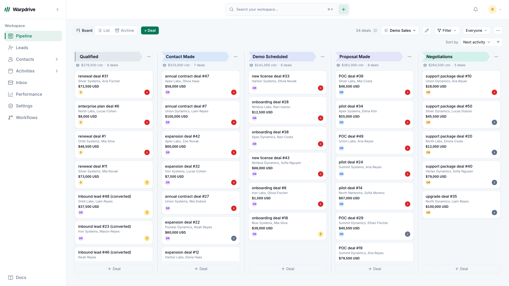

# warpdrive

**A self-hosted CRM for sales and relationship teams, built to work across languages.**

Manage your pipeline, customer records, conversations and follow-up on your own infrastructure.
Work in English, فارسی or Deutsch, with independent language, calendar, digit and time-zone
preferences.

[](https://github.com/KhademOHAli1/warpdrive/actions/workflows/ci.yml)
[](LICENSE)
[](package.json)

[Get started](#get-started) · [Documentation](#documentation) · [Roadmaps](#roadmaps) ·
[Contribute](#contributing)



_Screenshots illustrate the CRM and may precede the latest interface._

This is the maintained [KhademOHAli1/warpdrive](https://github.com/KhademOHAli1/warpdrive) fork of
[sneg55/warpdrive](https://github.com/sneg55/warpdrive). It retains the upstream history and MIT
attribution while developing the Bun runtime, multilingual experience and the roadmaps below.
The application is single-tenant: each installation runs its own application, database and
object storage. Connected providers process the data needed for their integrations.

## What you can use today

| Area                    | Current scope                                                                                                                                                               |
| ----------------------- | --------------------------------------------------------------------------------------------------------------------------------------------------------------------------- |
| Sales workspace         | Drag-and-drop pipelines, deals, stages, filters, notes, files and activity history.                                                                                         |
| Contacts and leads      | People, organizations, custom fields, relationships, a leads inbox and CSV import.                                                                                          |
| Email                   | Gmail OAuth/API and a separate generic IMAP/SMTP path, with mailbox ownership, threads and composing. Provider capabilities and qualification differ.                       |
| Activities and calendar | CRM-linked activities and localized event creation/editing, including Iranian date input and time-zone handling.                                                            |
| Manual workflows        | An early-access visual builder with deal reads, text/boolean conditions, follow-up tasks, simulation, publication, run history and cancellation.                            |
| Team and security       | Permissions, teams, invitation-only onboarding, configured sign-in methods, passkeys, authenticator apps and device sessions. Administrators require strong authentication. |
| Personal settings       | Regional and appearance preferences, security controls, privacy settings and notification preferences.                                                                      |

**Development status:** core CRM functionality and initial extension slices are integrated.
The full Sales, Calendar, Workflow, MAIL, Privacy, Agency and Integration roadmaps are still
in progress. Manual workflows have a deliberately limited action set. Advanced calendar
synchronization/conferencing, Microsoft Graph mail, Agency Projects and broader lifecycle
operations require further implementation or acceptance.

Use the [user guide](docs-site/docs/intro.md), [mail capability matrix](docs/email-provider-capabilities.md)
and [workflow status](docs/workflows/status.md) for feature-specific boundaries. Automated
checks, local previews, external-provider acceptance and a qualified deployment are recorded
separately.

## Languages and regional settings

English, Iranian Persian and German share the same application shell. Persian includes RTL
layout and contextual interface copy. Calendar, digits and time zone are saved independently
of interface language.

- Gregorian and Iranian Solar Hijri date input are available in the shared date controls.
- Dates retain their canonical storage/API representation; localized display does not rewrite
  stored records.
- Native currency values and separate currency totals avoid treating mixed currencies as one
  interchangeable amount.

See [regional settings](docs-site/docs/features/regional-settings.md),
[multiple currencies](docs/multicurrency.md) and the [localization glossary](docs/i18n-glossary.md).

## Get started

### Requirements

- **Bun 1.4.4**, as declared in the root [package.json](package.json).
- **PostgreSQL 16** and an S3-compatible object store with a private bucket.
- **SMTP delivery** for normal invitation, verification and recovery workflows.
- **Docker** for the disposable PostgreSQL integration-test lane, or the documented Compose
  deployment.
- Provider credentials for the connections you choose to enable.

The marketing site and documentation site are separate packages with their own version pins
and lockfiles.

### 1. Install and configure

```sh
git clone https://github.com/KhademOHAli1/warpdrive.git
cd warpdrive
bun install --frozen-lockfile
cp .env.example .env
```

Configure the database, object storage, public URLs, authentication and secrets using
[.env.example](.env.example) and the [deployment guide](docs/deploy.md). Use a dedicated
local database and set `BASE_URL=http://localhost:3000` for local development. Point storage
URLs at a browser-reachable endpoint and create the private bucket before testing uploads.

The Compose files currently reference unversioned MinIO server/client images. Confirm their
availability and choose appropriate pinned images, or configure another S3-compatible service,
before relying on a fresh Compose installation. The
[development override](docker-compose.dev.yml) exposes PostgreSQL on host port **5433**;
use the matching port in your local `DATABASE_URL`.

`AUTH_SMTP_*` delivers authentication notices. A customer's connected mailbox uses its own
Gmail or IMAP/SMTP credentials. Google sign-in and Gmail mailbox consent are separate.
The development `capture` mail transport does not deliver email; configure SMTP to exercise
normal onboarding.

### 2. Migrate and start the application

For a fresh, dedicated development database:

```sh
bun run db:migrate
bun run dev
```

Open **http://localhost:3000**. Start the worker and realtime server in separate terminals,
using the same configured environment:

```sh
# Background jobs
bun src/entrypoints/worker.ts
```

```sh
# Realtime updates on port 8080
bun src/entrypoints/ws.ts
```

For a host-local realtime server, set `WS_HOST=127.0.0.1` and configure both `WS_PUBLIC_URL`
and `NEXT_PUBLIC_WS_URL` consistently. The browser-facing `NEXT_PUBLIC_WS_URL` must also be
present when building the application.

### 3. Invite the first administrator

Set `SEED_ADMIN_EMAIL` to the intended owner's address, then queue that invitation:

```sh
bun run auth:operator bootstrap --email owner@example.com --name "Workspace owner" --locale fa --confirm
```

Use the configured address. Complete invitation acceptance, email verification and
administrator MFA in the normal interface. Keep `ALLOW_FIRST_LOGIN_ADMIN=false` for normal
authentication testing and production. The [operator runbook](docs/auth-operations.md) covers
bootstrap, delivery failures, invitations and recovery.

## Self-hosting and upgrades

The [Compose topology](docker-compose.yml) contains the application, WebSocket server,
background worker, migration runner, PostgreSQL, MinIO and Caddy. The
[deployment guide](docs/deploy.md) covers domains, HTTPS, SMTP, storage, provider credentials
and the packaged bootstrap command. Resolve the storage-image prerequisite above before
starting a fresh stack.

Production requires HTTPS, working authentication mail and installation-specific secrets.
Back up the database, private objects and required encryption/signing keys together, then
verify recovery. A database dump alone does not preserve every attachment or credential.

Before updating an existing installation, read the [upgrade guide](docs-site/docs/operations/updating.md),
[authentication migration report](docs/auth-implementation-report.md) and
[consolidated migration map](docs/mail-integrated-migration-map.md). Historical branch databases
can have incompatible migration histories. Their upgrade/restore path needs explicit
qualification; do not renumber applied migrations or replace an installed journal to bypass
admission checks.

## Roadmaps

Seven implementation roadmaps extend the CRM. Their plans preserve the full intended scope;
planned work and candidate code do not imply released functionality.

| Roadmap                            | Direction                                                                                                       | Plan and status                                                                                                                |
| ---------------------------------- | --------------------------------------------------------------------------------------------------------------- | ------------------------------------------------------------------------------------------------------------------------------ |
| Sales platform                     | Pipeline lifecycle, saved views, process templates, qualification, analytics and post-sale work.                | [Programme](docs/sales-platform/README.md) · [Approved plan](docs/sales-platform/approved/README.md)                           |
| Calendar                           | Reliable event workflows, reminders, recurrence, sharing, invitations and provider integrations.                | [Implementation plan](docs/calendar-implementation-plan.md) · [Workflow specification](docs/google-calendar-event-workflow.md) |
| Workflows and automation           | Extend the manual builder with CRM triggers, durable waits, additional actions and operational controls.        | [42-task plan](docs/workflows/implementation-plan.md) · [Status](docs/workflows/status.md)                                     |
| Email / MAIL                       | Provider-neutral mailbox workflows, delivery handling, private intake, recovery and provider qualification.     | [Capabilities](docs/email-provider-capabilities.md) · [Validation record](docs/mail-candidate-validation-status.md)            |
| Privacy and data lifecycle         | Governed requests, export, erasure, restriction, retention and recovery.                                        | [PRD](docs/PRD-warpdrive-privacy-data-lifecycle.md) · [Tasks](docs/privacy-data-lifecycle-tasks.md)                            |
| Agency projects                    | Optional internal client-project coordination, production templates, assignments, approvals and project margin. | Planned module; [CRM interface review](docs/sales-platform/agency-interface-review.md).                                        |
| Integrations, MCP and app platform | Connections, provider capabilities, consent, events and application-platform foundations.                       | [Programme](docs/integration-execution/README.md) · [Live task register](docs/integration-execution/tasks.csv)                 |

Settings, shared UX and main integration support these roadmaps. They are a cross-cutting
workstream, rather than an eighth product roadmap. Refer to each programme's dated evidence
for the revision and conditions actually checked.

## Development and checks

The root application uses Next.js and React, TypeScript, Drizzle/PostgreSQL, tRPC with
TanStack Query, shadcn/ui and Tailwind, pg-boss background jobs, S3-compatible storage and a
separate WebSocket service. Code is organized by feature under `src/features/`.

```sh
bun run typecheck          # Next type generation, then the configured TypeScript project
bun run lint               # Translation audit, Biome and type-aware ESLint
bun run test:unit          # Container-free unit lane
bun run test:integration   # Disposable real PostgreSQL through Testcontainers
bun run build              # Application production build
bun run build:workers      # Worker, WebSocket, migration and operator bundles
```

Use the configured `typecheck` script: it generates declarations needed by the application's
type tests. Integration tests exercise the real migrations and database, rather than mocking
queries. Build and test evidence applies to its exact source revision and environment.

## Documentation

- [Documentation index](docs/README.md) and [user guide](docs-site/docs/intro.md).
- [Architecture](docs-site/docs/architecture.md) and [deployment](docs/deploy.md).
- [Mailbox guide: English](docs/mailbox-guide.en.md), [فارسی](docs/mailbox-guide.fa.md),
  [Deutsch](docs/mailbox-guide.de.md).
- [Authentication operations: English](docs/auth-operations.md), [فارسی](docs/auth-operations.fa.md),
  [Deutsch](docs/auth-operations.de.md).
- [Privacy inventory](docs/privacy-data-inventory.md) and [shared UI maintenance](docs/ui-updates.md).

## Contributing

Read [the contribution guide](docs-site/docs/contributing.md), [AGENTS.md](AGENTS.md) and
[CLAUDE.md](CLAUDE.md). Keep changes focused, preserve other contributors' work and add
meaningful failing tests before implementing new behavior or fixing a bug. Use the declared
Bun version and lockfile, retain permission boundaries, and update user-facing documentation
when behavior changes.

Changes reach `main` through sequential integration. Preserve unfinished work and close
completed branches after verifying their contents. Include the checks actually run and
remaining limitations in each contribution.

## License and attribution

[MIT](LICENSE). Original copyright: **Nikita Sawinyh**. This fork preserves the upstream license
and attribution. Warpdrive is independent software and is not affiliated with or endorsed by
Pipedrive.
