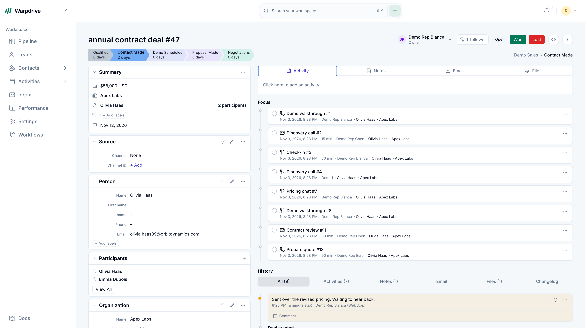
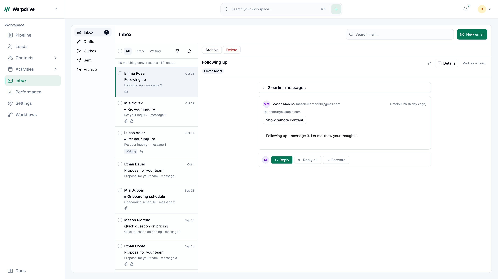
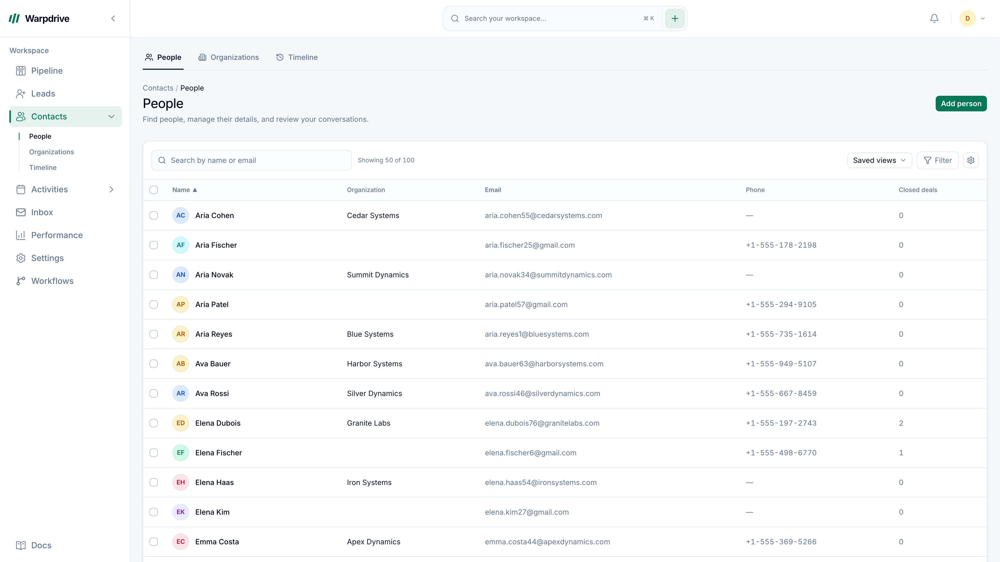

<h1 align="center">warpdrive</h1>

<p align="center">
  An open-source, self-hosted <b>Pipedrive alternative</b> for business-development teams.<br/>
  Your pipeline, customers and conversations, on your own infrastructure.<br/>
  Built for English, فارسی and Deutsch.
</p>

<p align="center">
  <a href="LICENSE"></a>
  
  
  
  
  
</p>

<p align="center">
  <a href="https://github.com/KhademOHAli1/warpdrive/actions/workflows/ci.yml"></a>
</p>

<p align="center">
  
</p>

warpdrive brings the core business-development workflow into software you run yourself:
move deals through a pipeline, keep customer context together and follow up from one
workspace. It is **single-tenant and self-hosted**, with your own application, PostgreSQL
and object storage. There is no per-seat application license fee; hosting, operations and
connected services have their own costs.

This [maintained fork](https://github.com/KhademOHAli1/warpdrive) builds on
[upstream Warpdrive](https://github.com/sneg55/warpdrive), preserving its history and MIT
attribution. It adds the Bun runtime, contextual Persian/German workflows, Iranian date
input and the ongoing CRM roadmaps below. Core records live on your infrastructure;
connected mail, identity and other providers process the data used by their integrations.

## Contents

- [Features](#features)
- [Screenshots](#screenshots)
- [warpdrive vs Pipedrive](#warpdrive-vs-pipedrive)
- [Tech stack](#tech-stack)
- [Quickstart (local development)](#quickstart-local-development)
- [Languages and regional settings](#languages-and-regional-settings)
- [Self-hosting and upgrades](#self-hosting-and-upgrades)
- [Tests and checks](#tests-and-checks)
- [Project status](#project-status)
- [Roadmaps](#roadmaps)
- [Documentation](#documentation)
- [Contributing](#contributing)
- [License](#license)

## Features

**Pipeline**

- Kanban board with drag-and-drop deals, multiple pipelines and custom stages
- Per-stage weighted totals, rotting-deal indicators and saved filters
- Board, list and archive views

**Deals**

- A deal workspace with activities, notes, files, email and change history
- Participants, followers, labels, lost reasons and close dates
- Won/lost handling and a visible stage-progress bar

**Contacts**

- People and organizations with custom fields
- Organization firmographics and organization-to-organization relationships
- Leads inbox and CSV import with an undo step

**Email**

- Two-way Gmail through OAuth/API, with threads linked to deals and people
- A separate generic IMAP/SMTP path, verified TLS and multiple personal mailboxes
- Templates, signatures, merge fields, open/click tracking and scheduled send

Provider capabilities and acceptance differ. The [mailbox guide](docs/mailbox-guide.en.md)
and [capability matrix](docs/email-provider-capabilities.md) record the current boundaries.

**Activities and workflows**

- CRM-linked activities and a localized calendar event editor
- Iranian date input and time-zone-aware editing
- An early-access visual workflow builder with manual start, deal reads, conditions,
  follow-up tasks, simulation, publication, run history and cancellation

**Team and platform**

- Role-based permissions, teams, notifications and basic pipeline statistics
- Invitation-only onboarding and configured sign-in methods, with administrator MFA
- Passkeys, authenticator apps, recovery codes and device-session controls
- Realtime board, inbox, notification and presence updates over WebSocket
- Regional, appearance, privacy and notification preferences

## Screenshots

**Deal workspace:** customer context, activities, notes, files and history in one view.



**Inbox:** conversations, follow-up labels and CRM links.



**Contacts:** people, organizations and custom fields.



_English interface captured on 1 November 2026 using synthetic demo data._

## warpdrive vs Pipedrive

warpdrive offers a self-hosted foundation for the core sales workflow. This fork also has
seven active implementation roadmaps. The comparison distinguishes current features,
early-access capabilities and planned work.

| Feature                                        |                   warpdrive                   |                 Pipedrive                  |
| ---------------------------------------------- | :-------------------------------------------: | :----------------------------------------: |
| Software                                       |               MIT, open source                |              Commercial SaaS               |
| Hosting                                        |          Self-hosted, single-tenant           |                Vendor cloud                |
| Application pricing                            |            No per-seat license fee            |           Paid per seat, by plan           |
| Core data storage                              |        Your database and object store         |               Vendor-hosted                |
| Kanban pipelines and custom stages             |                      ✅                       |                     ✅                     |
| Multiple pipelines                             |                      ✅                       |                     ✅                     |
| Deals, activities, notes and files             |                      ✅                       |                     ✅                     |
| People, organizations and custom fields        |                      ✅                       |                     ✅                     |
| Leads inbox and CSV import                     |                      ✅                       |                     ✅                     |
| Gmail send/receive and tracking                |              ✅ Configured OAuth              |            ✅ Growth and above             |
| Generic IMAP/SMTP mailboxes                    | ◐ Implemented, provider qualification ongoing |  ✅ Supported providers, Growth and above  |
| Email templates, signatures and scheduled send |                      ✅                       |            ✅ Growth and above             |
| Permissions and user management                |                      ✅                       |         ✅ Plan-dependent controls         |
| Notifications                                  |                      ✅                       |                     ✅                     |
| Native currency values                         |          ✅ Separate currency totals          |           ✅ Multiple currencies           |
| Pipeline reports                               |     ✅ Basic; advanced analytics planned      | ✅ Insights; forecasts on Growth and above |
| Visual workflow automation                     |       ◐ Manual workflows, early access        |     ✅ Automations on Growth and above     |
| Calendar event editing                         |                      ✅                       |                     ✅                     |
| External calendar synchronization              |                    Planned                    |          ✅ Google and Microsoft           |
| Project coordination                           |             Planned Agency module             |             ✅ Plan or add-on              |
| Product catalog                                |              ➖ Not implemented               |                     ✅                     |
| Marketplace and web forms                      |              ➖ Not implemented               | ✅ Marketplace; LeadBooster plan or add-on |
| Native mobile apps                             |              Responsive web app               |             ✅ iOS and Android             |

✅ implemented · ◐ limited or early access · Planned = roadmap work · ➖ unavailable

Pipedrive availability varies by plan and add-on. Comparison checked **1 November 2026**
against its [feature matrix](https://support.pipedrive.com/en/article/what-features-do-the-pipedrive-plans-have),
[pricing](https://www.pipedrive.com/en/pricing), [hosting information](https://support.pipedrive.com/en/article/how-secure-is-my-data-in-pipedrive)
and [currency support](https://www.pipedrive.com/en/features/multilingual-multi-currency).
Feature depth and provider behavior differ; use the linked guides for the exact scope.

## Tech stack

Next.js and React with TypeScript, Drizzle ORM on PostgreSQL, tRPC with TanStack Query,
Next server actions, shadcn/ui with Tailwind, dnd-kit, Zustand, pg-boss background jobs,
S3-compatible storage and a self-hosted WebSocket server backed by PostgreSQL LISTEN/NOTIFY.
Authentication uses Better Auth. The root application uses **Bun 1.4.4**.

## Quickstart (local development)

Requires Bun 1.4.4, PostgreSQL 16, a private S3-compatible bucket and configured authentication
mail. Docker is used by the integration-test lane and the supplied Compose topology.

```sh
git clone https://github.com/KhademOHAli1/warpdrive.git
cd warpdrive
bun install --frozen-lockfile
cp .env.example .env
```

Configure [.env](.env.example) using the [deployment guide](docs/deploy.md): database, storage,
public URLs, authentication and secrets. For local development use
`BASE_URL=http://localhost:3000`. Storage must be browser-reachable and the private bucket
must exist before testing uploads.

The Compose files reference unversioned MinIO server/client images. Confirm their availability
and pin suitable images, or provide another S3-compatible service, before a fresh installation.
The [development override](docker-compose.dev.yml) exposes PostgreSQL on host port **5433**;
match that port in your local `DATABASE_URL`.

With a fresh, dedicated development database and configured environment:

```sh
bun run db:migrate
bun run dev
```

Open **http://localhost:3000**. Run the background worker and realtime service in separate
terminals with the same environment:

```sh
# Background jobs
bun src/entrypoints/worker.ts
```

```sh
# Realtime updates on port 8080
bun src/entrypoints/ws.ts
```

For a host-local realtime service set `WS_HOST=127.0.0.1`. Configure `WS_PUBLIC_URL` and
`NEXT_PUBLIC_WS_URL` consistently; the browser-facing URL is also required at build time.

Set `SEED_ADMIN_EMAIL`, then queue the first administrator's invitation using that address:

```sh
bun run auth:operator bootstrap --email owner@example.com --name "Workspace owner" --locale fa --confirm
```

Complete invitation acceptance, email verification and administrator MFA in the normal UI.
The `capture` mail transport does not deliver email; use SMTP for normal onboarding.
`AUTH_SMTP_*` delivers authentication notices, separately from a user's connected mailbox.
Google sign-in and Gmail mailbox consent are separate. Keep `ALLOW_FIRST_LOGIN_ADMIN=false`
for normal authentication testing and production. See the [operator runbook](docs/auth-operations.md).

## Languages and regional settings

Work in **English, فارسی or Deutsch** in the same application shell. Persian uses RTL layout
and contextual wording. Language, calendar, digits and time zone are independent preferences.
Gregorian and Iranian Solar Hijri date input are available in the shared controls; localized
display preserves canonical stored dates and API values. Currency totals remain separated
by their native currency.

See [regional settings](docs-site/docs/features/regional-settings.md),
[the glossary](docs/i18n-glossary.md) and [multiple currencies](docs/multicurrency.md).

## Self-hosting and upgrades

The [single-box Compose topology](docker-compose.yml) includes the app, WebSocket service,
worker, migration runner, PostgreSQL, MinIO and Caddy. After configuring the domain, SMTP,
storage images and secrets, follow the [deployment guide](docs/deploy.md) for HTTPS startup
and the packaged administrator bootstrap command.

Production requires HTTPS, working authentication mail and installation-specific secrets.
Back up the database, private objects and encryption/signing keys together, then verify
recovery. A database dump alone does not preserve every attachment or credential.

Before updating, read the [upgrade guide](docs-site/docs/operations/updating.md),
[authentication migration report](docs/auth-implementation-report.md) and
[consolidated migration map](docs/mail-integrated-migration-map.md). Historical branch
databases can have incompatible migration histories requiring explicit upgrade/restore
qualification. Preserve applied SQL and installed journals.

## Tests and checks

```sh
bun run typecheck          # Next type generation and the configured TypeScript project
bun run lint               # Translation audit, Biome and type-aware ESLint
bun run test:unit          # Container-free unit tests
bun run test:integration   # Disposable real PostgreSQL through Testcontainers
bun run build              # Application production build
bun run build:workers      # Worker, realtime, migration and operator bundles
```

Use the configured `typecheck` script to generate the declarations required by type tests.
Integration tests exercise the real database and migrations. Evidence applies to its exact
source revision and environment. The marketing and documentation sites have their own Bun
version pins, lockfiles and checks.

## Project status

This fork is actively developed. Core CRM functionality and initial extension slices are
integrated, with English, Persian and German workflows. The manual workflow builder is early
access. Advanced automation, calendar synchronization/conferencing, Microsoft Graph mail,
Agency Projects and broader data-lifecycle operations remain in progress.

Source implementation, automated checks, browser acceptance, external-provider qualification
and deployment are tracked separately. The [documentation index](docs/README.md) and each
roadmap's evidence record describe the current scope; plans and previews are not release claims.

## Roadmaps

Seven implementation roadmaps extend the CRM:

1. **Sales platform:** pipeline lifecycle, views, templates, analytics and post-sale work.
   [Programme](docs/sales-platform/README.md) · [Approved plan](docs/sales-platform/approved/README.md)
2. **Calendar:** event workflows, reminders, recurrence, sharing and provider integrations.
   [Implementation plan](docs/calendar-implementation-plan.md) · [Workflow specification](docs/google-calendar-event-workflow.md)
3. **Workflows and automation:** triggers, durable waits, additional actions and operational controls.
   [Plan](docs/workflows/implementation-plan.md) · [Status](docs/workflows/status.md)
4. **Email / MAIL:** mailbox workflows, delivery handling, private intake, recovery and provider acceptance.
   [Capabilities](docs/email-provider-capabilities.md) · [Validation](docs/mail-candidate-validation-status.md)
5. **Privacy and data lifecycle:** requests, export, erasure, restriction, retention and recovery.
   [PRD](docs/PRD-warpdrive-privacy-data-lifecycle.md) · [Tasks](docs/privacy-data-lifecycle-tasks.md)
6. **Agency projects:** internal client projects, templates, assignments, approvals and project margin.
   Planned module; [CRM interface review](docs/sales-platform/agency-interface-review.md).
7. **Integrations, MCP and app platform:** connections, capabilities, consent, events and platform foundations.
   [Programme](docs/integration-execution/README.md) · [Live register](docs/integration-execution/tasks.csv)

Settings, shared UX and main integration are the supporting cross-cutting workstream.

## Documentation

- [Documentation index](docs/README.md) and [user guide](docs-site/docs/intro.md)
- [Architecture](docs-site/docs/architecture.md) and [deployment](docs/deploy.md)
- [Mailbox guide: English](docs/mailbox-guide.en.md), [فارسی](docs/mailbox-guide.fa.md), [Deutsch](docs/mailbox-guide.de.md)
- [Authentication operations: English](docs/auth-operations.md), [فارسی](docs/auth-operations.fa.md), [Deutsch](docs/auth-operations.de.md)
- [Privacy inventory](docs/privacy-data-inventory.md) and [shared UI maintenance](docs/ui-updates.md)

## Contributing

Read the [contribution guide](docs-site/docs/contributing.md), [AGENTS.md](AGENTS.md) and
[CLAUDE.md](CLAUDE.md). Keep changes focused, preserve other contributors' work and add
meaningful failing tests before new behavior or a bugfix. Use the declared Bun version and
lockfile, retain permission boundaries and update documentation with behavior changes.

Changes reach `main` through sequential integration. Preserve unfinished work, close completed
branches after verifying containment, and report the checks actually run and remaining limits.

## License

MIT. See [LICENSE](LICENSE). Original copyright: **Nikita Sawinyh**. This fork preserves the
upstream attribution. Warpdrive is independent software, not affiliated with or endorsed by
Pipedrive.
