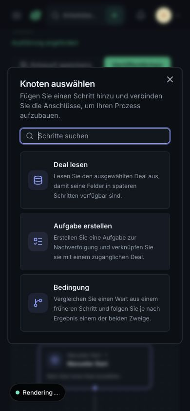
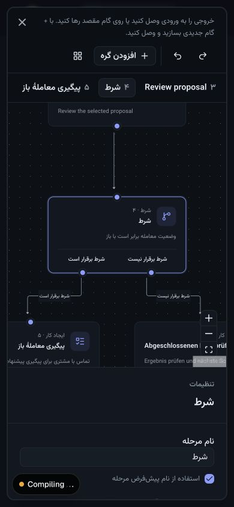
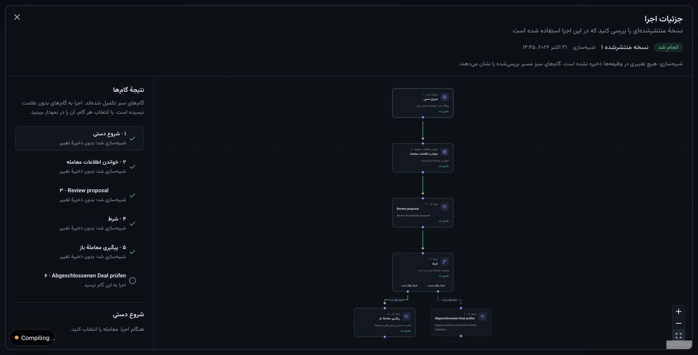

# Visual workflows

Use a workflow to connect a trigger to CRM actions. The editor and available
actions depend on your installation and permissions. This guide covers a manual
workflow and how to check it before running it on real records.

## Start a workflow

Open **Workflows**. If you see **New workflow**, choose it, enter a name, and
select **Create workflow**. In **Workflow studio**, a new draft starts with
**Launch manually**. To edit an existing workflow, open it from the list. Older
workflows can open in the earlier editor.

## Connect the process

In Workflow studio, select the trigger and choose **Add step**. Connect an
output to the next step and review the resulting path on the canvas. If a step
offers multiple outcomes, check each outcome's destination.

In the earlier editor, use **Add node**, or use **+ Next step** on a node to
add and connect a step in one action. To insert a step on an existing path,
open the upstream node's **Connections** panel and choose **Insert a step
here**. You can also select source and destination ports on the canvas.

## Configure nodes

Select a step and open **Configure**. Enter a fixed value or choose an output
from an earlier step. If you remove or move a step, check the fields that used
its outputs before you publish. Review the outcome paths for a condition and
the delay on any wait step.

In the earlier editor, a manual deal workflow can read a deal, evaluate a
condition, wait, and create a follow-up task. Workflow studio shows the blocks
and configuration your installation offers. If a block reports **Needs setup**
or **Permission required**, resolve that before publishing.

## Save, publish, and simulate

1. Select **Save draft** before leaving the editor. If there is a save conflict,
   check the newer revision before applying your edits again.
2. In Workflow studio, use **Safe test** to check the draft with synthetic
   action results. A passing test gives you a preview of the workflow path.
   Verify any connected provider separately before relying on it.
3. Choose **Publish** when the workflow is ready. Confirm your identity in
   **Settings > Security** if prompted, then retry. Publishing makes a version
   available to run. Later draft edits need another publication to take effect.

In the earlier editor, use the available draft test to preview edits. Use
**Simulate** to exercise a published workflow with a visible record without
creating real tasks.

## Run and inspect

In Workflow studio, use **Run live** for a published manual workflow and follow
the confirmation. In the earlier editor, choose **Run workflow** and select the
record. A live run can change real records, so check the trigger, record, and
published version before confirming.

Open **Runs** or **Run history**, depending on the editor, to check the status
and completed steps. A waiting run can resume after its scheduled time when
the worker is ready. **Pause** prevents new runs from starting. Use the run
details to see which recovery actions are available for that run.

The screenshots show the earlier editor with synthetic records from October 2026.

## Permissions and languages

The controls available depend on your permissions and workflow ownership.
Publishing requires recent identity confirmation. The editor follows your
account language and display direction. Review the time zone and date shown
in run history using your [regional settings](./regional-settings.md).

## Remaining delivery stages

Use the editor's readiness status to confirm the blocks, triggers, and
connections available for your workflow. For project status, see the
[workflow roadmap](https://github.com/KhademOHAli1/warpdrive/issues/10).

### Step numbers after inserting a step

In the earlier editor, the step list, canvas, run trace, connection selectors,
and variable references show steps in dependency order. After inserting a
step, review the new numbering and its input mappings before publishing.
