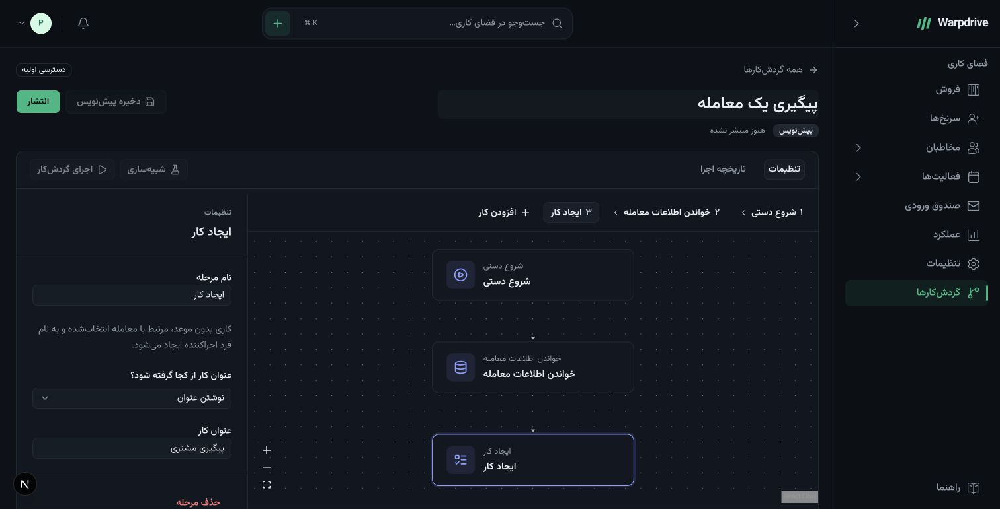

# Visual workflows

**Early access:** the first workflow editor supports a manual start, reading a visible deal,
and creating one or more follow-up tasks. Automatic CRM triggers, conditions, waits, email,
and provider integrations remain in development. Existing email scheduling and reminders
continue to use their existing workers.

## Create and configure

Open **Workflows** in the sidebar and choose **New workflow**. Name your workflow, then
configure the follow-up template. Choose a step on the canvas or in the keyboard-accessible
step selector. The settings panel lets you rename a step and enter a task title or use the
deal title from the preceding read step. Add or remove task steps as needed.

The initial task action creates an undated task linked to the chosen deal and assigned to
the person who starts the run. Assignees, due dates, other activity types, and arbitrary
record modifications are not configurable in this release.

Current early-access Farsi UI, captured 31 October 2026 with synthetic local data.

**Save draft** preserves edits. Drafts and published versions are separate. A conflicting
save leaves your draft in the editor and asks you to reconcile it, rather than overwriting
another user's changes.

## Publish and simulate

**Publish** validates the graph and mappings, requires recent authentication through
Settings > Security, and activates an immutable version. Editing afterwards changes only
the draft. Existing runs retain their original published version.

Select **Simulate**, search for a deal you can access, select it, and confirm. Simulation
uses the published version and the same CRM validation as a live run, then rolls back task
changes. Run history is retained. Publication is currently required before simulation.

## Run and inspect

Select **Run workflow**, choose a deal, and review the confirmation. This creates real
tasks. Runs are processed by the background worker, even after the browser closes. A
missed enqueue is recovered at worker startup or by its minutely reconciliation job.

**Run history** shows simulation/live mode, status, timestamps, completion count, and stable
failure IDs. Raw CRM inputs and outputs are withheld because historical access may change.
Detailed redacted step payloads and manual retry are later milestones.

**Cancel run** stops subsequent steps; already committed tasks remain. **Pause** prevents
new runs while previously admitted runs continue. Publishing reactivates a paused workflow.
The worker checks the initiating user's current permissions and deal visibility again at
each step. Losing access or being deactivated stops the run.

## Permissions and languages

Workflow permissions are view, create, edit, publish, run, and cancel. Regular users need
the corresponding permission and ownership. Administrators retain explicit administrative
authority. Publishing is classified as high risk and requires fresh authentication.

The interface supports English, Farsi RTL, and German through the shared language system.
Run timestamps follow the account's calendar, timezone, and digit preferences, including
the Iranian calendar. Calendar display does not enable Iranian recurring schedules.

## Remaining delivery stages

The repository's `docs/workflows/` directory contains the approved 42-task plan, exact
Mobbin flow references, architecture, operational instructions, and verification ledger.
The initial manual workflow is one milestone within R1. CRM events, richer actions,
conditions, waits, notifications, controlled email, operational limits, and retention
remain before the full R1 production candidate. Calendar-aware recurrence and provider
connections follow in R2; approvals, loops, and sub-workflows follow in R3.
