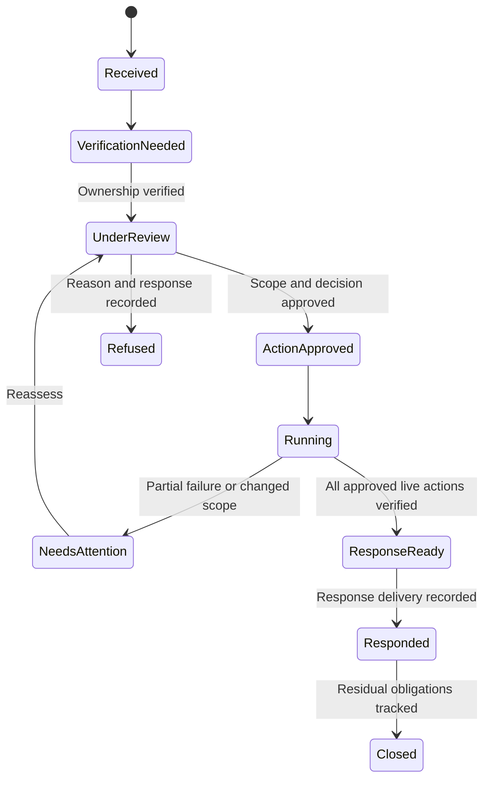

# PRD: Warpdrive privacy and data lifecycle

Status: authorized for planning and full implementation in a separate chat. Date: 31 October 2026. No implementation task is complete merely because this plan exists.

Companion documents: [task backlog](privacy-data-lifecycle-tasks.md) and [acceptance test design](privacy-data-lifecycle-tests.md).

## 1. Summary

Build practical privacy and data-lifecycle workflows for the open-source Warpdrive CRM: requests about personal data, controlled export, correction, restriction, account closure, erasure, retention and recovery operations. Preserve the current application design and provide complete Farsi, German and English workflows. Deliver tested software and verifiable release evidence, with installation-specific acceptance recorded separately from source implementation.

## 2. Ownership and decisions

| Owner                               | Responsibility                                                                                                                                                                            |
| ----------------------------------- | ----------------------------------------------------------------------------------------------------------------------------------------------------------------------------------------- |
| Ali                                 | Product scope, deployment choices, acceptance of real external actions and installation-specific policies.                                                                                |
| Implementation chat                 | Implement the task backlog, write tests first, preserve peer work, maintain evidence and publish reviewable changes.                                                                      |
| Installation operator               | Configure the controller identity, deployment secrets, retention policy, backup destinations and designated test accounts. This is an operational role, not an assumed additional person. |
| Controller's privacy/legal reviewer | Decide applicable grounds, exceptions, notices, contractual obligations and jurisdiction-specific policy. The software records decisions and does not invent legal approval.              |

The user has requested full implementation. Routine reversible implementation and synthetic testing should proceed without another general permission request. Real erasure, external messages, production deployment, contract acceptance and other consequential live actions retain their specific authorization requirements.

## 3. Verified starting point

Repository: `https://github.com/KhademOHAli1/warpdrive`, with upstream `sneg55/warpdrive` retained. Healthy checkout: `/Users/ali/Developer/warpdrive`. Verified main: `a1a8f6da1ce366c35002900bf33508356dfbb995`.

- [Authentication CI](https://github.com/KhademOHAli1/warpdrive/actions/runs/41207704880) passed 5,732 unit tests, 2,054 PostgreSQL tests and the CRM, worker, marketing and documentation builds.
- Better Auth supports native password, MFA, recovery codes, passkeys and provider workflows. [Recovery qualification](auth-recovery-verification.md) covers local SMTP in Farsi/German, expiry, replay, session revocation and retained factors. Real external delivery and physical devices remain installation checks.
- Account closure currently requests administrative handling. Offboarding revokes access and transfers ownership where selected; this is not general erasure of personal data.
- `src/features/contacts/deletePerson.ts` soft-deletes a person. Recoverable deletion is not equivalent to verified erasure.
- Lead CSV export exists. It is not a complete subject-access or portability workflow.
- Current auth maintenance clears completed mail bodies after seven days and removes auth audit/outbox metadata after 180 days. These are existing technical defaults, not a universal legal retention policy.
- PostgreSQL, MinIO/S3 files, email bodies and attachments, drafts, notes, comments, custom fields, change-log snapshots, imports, notifications, realtime payloads, credentials, queued jobs and backups all require classification. Shared record ownership must not be mistaken for identity of the data subject.
- Other active work exists in `/Users/ali/Developer/warpdrive-integrations` and `/Users/ali/Developer/warpdrive-calendar`. Inspect their current state and preserve it. Main has received the auth changes; do not resume or take over those workstreams.

The new capability is a coherent privacy case and adapter layer over the existing auth, permissions, jobs and storage boundaries. It must work with today's Gmail implementation and accommodate the independently evolving non-Gmail integrations through explicit interfaces.

## 4. Objective and measurable outcomes

Business outcome: installations can operate inspectable privacy workflows and demonstrate what was actually executed. Customer outcome: people receive understandable, appropriately scoped responses without exposing other people's information or silently destroying shared business records.

| Key result                                       | Baseline                                                      | Accepted target                                                                                                                                                            | Gate             |
| ------------------------------------------------ | ------------------------------------------------------------- | -------------------------------------------------------------------------------------------------------------------------------------------------------------------------- | ---------------- |
| KR1: classified personal-data stores and writers | No verified whole-product coverage register                   | 100% of discovered schema tables, object namespaces, queues, derived stores, external recipients and backups classified; a new unclassified store fails the coverage check | M1               |
| KR2: accepted case workflows                     | Existing auth/closure and entity-specific export/delete paths | Every required task and mapped acceptance scenario passes; unresolved exclusions remain visible and prevent false completion                                               | M2-M4            |
| KR3: authorization and locale coverage           | Auth and permission foundations exist                         | All new workflows and states covered in FA, DE and EN, with negative authorization and race tests at server boundaries                                                     | Every milestone  |
| KR4: verifiable release                          | Source/auth qualification only                                | All automated gates green, reproducible restore and failure drills, and every required installation acceptance gate evidenced or explicitly OPEN                           | Final acceptance |

Use relative milestones, not an invented delivery date. Milestone sizing is a planning estimate; reassess after the inventory.

## 5. Users and jobs

| Segment                                  | Job and problem                                                                                                                                            |
| ---------------------------------------- | ---------------------------------------------------------------------------------------------------------------------------------------------------------- |
| Workspace operators and reviewers        | Identify the relevant records, apply a justified decision, see exceptions and produce a trustworthy completion record.                                     |
| People exercising rights                 | Request access, correction or another supported action through a clear channel without needing a CRM account or disclosing unnecessary identity documents. |
| Team members handling shared CRM records | Continue legitimate work while respecting restrictions, deletion decisions, permissions and ownership transfers.                                           |
| Deployment maintainers                   | Restore service without reintroducing erased records, expired credentials or revoked access.                                                               |

Farsi or German selection does not determine jurisdiction, residence or legal entitlement. A CRM contact and an employee/user account are distinct subject types that may be explicitly linked after review.

## 6. Product value and boundaries

| Dimension           | Intended outcome                                                                                                                     |
| ------------------- | ------------------------------------------------------------------------------------------------------------------------------------ |
| Understandability   | Clear distinction between closing access, soft deletion, redaction, pseudonymization and irreversible erasure.                       |
| Inspectability      | A reviewer can see scope, policy, holds, exclusions, actor, evidence, failures and the actual final state.                           |
| Safety              | Fresh authentication, specific case permissions, identity checks and approved previews protect sensitive operations.                 |
| Completeness        | Personal data in snapshots, artifacts, files and restored backups is handled explicitly.                                             |
| Operational honesty | A revoked local token is not described as remotely deleted provider data; a source test is not described as a production acceptance. |

This is engineering support for privacy operations, not an automated legal certification or a promise that every request must result in every record being disclosed or deleted.

## 7. Solution

### Five implementation packages

1. P0: inventory, privacy permissions, case management, subject verification and policy decisions.
2. P0: subject discovery, appropriately scoped export and secure delivery.
3. P0: correction, restriction, objection, closure and reviewed erasure, including concurrent writers.
4. P0: retention, object cleanup, deletion/revocation records and restore protection.
5. P0: localized interfaces, security qualification, operational evidence and release acceptance. Supporting P1 tasks in the backlog are part of the requested full implementation, not optional omissions.

### User workflows and design

- Preserve the current Warpdrive shell, typography, tokens and settings layout. Use existing shadcn/Radix adapters, with `docs/ui-updates.md` governing changes. Do not redesign login again.
- Personal settings: a privacy/data area to request one's information, see verified status, obtain an approved archive and request closure. It does not grant an employee access to every CRM record they own.
- Administrative settings: a case queue with filters, due dates, subject matches, ownership verification, review notes, export preview, erasure preview, holds, decisions, failures and audit evidence. Integrate with the established administration navigation.
- External subjects: an operator-assisted intake path and generic public acknowledgement. Authenticate/verify the recipient before revealing matches or issuing delivery credentials. No mandatory CRM registration.
- Erasure confirmation: explain irreversible actions, transferred/shared records, retained exceptions, external recipients and backup residuals. Approval binds to an exact preview version and expires when scope or policy changes.
- Use accessible dialogs, keyboard navigation, progress, cancellation, retry, partial failure and empty states. Long work uses durable jobs, not a browser tab holding the only copy of progress.
- Farsi copy must be idiomatic. Keep addresses, opaque identifiers and credentials LTR within RTL. Show dates in the selected calendar/time zone; persist canonical instants and calendar-month deadlines independently of display language. German copy uses consistent formal address. English remains complete.

Case lifecycle and job lifecycle must be separate: a completed export job does not close the request, and partial erasure does not become a successful response automatically. Track outstanding provider or backup obligations explicitly.

### Technical contracts

- Put implementation under feature-owned modules such as `src/features/privacy/`, with narrow integration points in auth, permissions, email, imports, files, jobs and settings. Reuse Result types, the error registry, the single environment boundary and required AbortSignals.
- Introduce a versioned data-store registry. Each adapter declares subject matching, data categories, visibility/disclosure rules, export, correction/restriction/erasure behavior, retention, external effects and supported proof. Unknown capability is an explicit blocker or reviewed exclusion, not silent success.
- Case identity is an internal opaque ID, not an email address in a URL. Normalize identifiers only for matching. Never merge people merely because an address matches; support aliases, shared addresses and changed addresses.
- Privacy authority is explicit. Do not rely on the generic admin bypass in `can()` as the only case disclosure/erasure decision. Require the relevant privacy capability, ownership verification, case scope and fresh authentication on the server; invalidate authorization when the actor is suspended or loses that capability.
- Archive format: a versioned UTF-8 JSON manifest, metadata, appropriate CSV and authorized attachments in a private archive. Record exclusions and transformations. Include original EML only when available; reconstructed content must be labeled. Escape spreadsheet formulas and sanitize archive paths. Do not fetch remote email images or URLs during export.
- Build exports from a stable reviewed scope. Use durable leases, checkpoints, idempotency keys, bounded pages, quota controls, cancellation and integrity hashes. Recheck authorization at execution, publication and download.
- Download by a revocable authenticated endpoint or verified-recipient mechanism. Do not put personal data or long-lived bearer links in logs, referrers, analytics or publicly listable storage. Support legitimate retries/range transfer without turning a single-use grant into an account-independent public URL.
- Erasure uses a deterministic preview, approved holds/exceptions, generation/version checks and resumable execution. Preserve required foreign keys and shared records through explicit transfer, redaction or pseudonymization. Do not call retained identifiable data anonymous.
- Cover free text, attachments, historical old/new values, custom JSON, imports, drafts, notifications, queued payloads, indexes/caches and external copies. Unsupported or uncertain items remain visible for review. Automated PII detection is advisory, not proof of erasure.
- Prevent resurrection by imports, email sync, enrichment, retrying jobs, outbox sends and restore operations. Define and test lock ordering against the existing auth account/MCP grant/owner locks. Fence stale work and publish invalidation only after commit.
- Maintain a minimal protected deletion/revocation record outside rollback of a database snapshot. Matching identifiers/hashes may still be personal data: justify, minimize and bound their retention. Do not implement an unlimited hidden address blacklist as an erasure shortcut.
- External providers use capability-specific operations and durable outcomes. Local disconnection, remote grant revocation and remote data deletion have different receipts. Real external deletion requires specific operator authorization and provider support.

### Proposed defaults and policy decisions

| Area                       | Default for implementation                                                           | Control/acceptance                                                                                                                                                                                                                           |
| -------------------------- | ------------------------------------------------------------------------------------ | -------------------------------------------------------------------------------------------------------------------------------------------------------------------------------------------------------------------------------------------- |
| Export artifact lifetime   | 24 hours                                                                             | Visible configurable maximum; automatic object/metadata cleanup tested.                                                                                                                                                                      |
| Download authorization     | Five-minute grant or equivalent short-lived session-bound transfer                   | Revocation, expiry, fresh authorization, replay and range semantics tested.                                                                                                                                                                  |
| Erasure approval           | Specific preview version, valid at most 24 hours                                     | Any relevant subject, policy, hold or scope change invalidates approval.                                                                                                                                                                     |
| Case identity evidence     | Minimum confirmation metadata; no identity-document upload by default                | Additional evidence requires an explicit justified review and controlled retention.                                                                                                                                                          |
| Active CRM data purge      | Disabled until the operator activates a documented retention policy                  | No universal deletion period inferred from language or market. Dry run before activation.                                                                                                                                                    |
| Existing auth housekeeping | Preserve the current seven-day/180-day behavior pending an explicit policy migration | Display and test current defaults; never present them as statutory periods.                                                                                                                                                                  |
| New case metadata          | Operator-selected policy, with 180 days only a proposed engineering starting point   | Holds and justified exceptions take precedence; no destructive schedule until policy activation.                                                                                                                                             |
| Notifications              | In-app status and localized templates; verified recipient delivery only              | No email archive attachment or automatic regulator/customer notification.                                                                                                                                                                    |
| Scale fixture              | 10,000 related records and 100 MiB attachment data                                   | Bounded pages of at most 100 records, no whole-archive buffering, target peak memory overhead at most 256 MiB and cancellation observed within five seconds on the recorded qualification profile. Record changes to this target explicitly. |

Policy choices must appear in a decision register with owner, rationale, affected tests and activation state. Unknown company identity, legal basis, jurisdiction, provider contract, backup location or retention mandate is not filled with invented facts. Continue independent implementation while requesting only the missing input needed for dependent acceptance.

### Legal and operational reference points

Rights depend on circumstances. Access and portability have different scopes; identity checks should be proportionate, requests must be tracked, and disclosure must account for other people. For the EU profile, model the normal one-calendar-month response deadline and a reviewed extension workflow with timely notice, rather than a universal fixed day count. These are workflow requirements informed by [EDPB rights guidance](https://www.edpb.europa.eu/sme/be-compliant/respect-individuals-rights_en).

Record controller/processor roles and who decides the response. For breach handling, distinguish controller assessment/notification duties from a processor's notification to the controller. Track awareness, risk assessment, the applicable 72-hour authority-notification deadline and communications when required; no unconditional automatic report. See [EDPB breach guidance](https://www.edpb.europa.eu/sme/assess-the-risks/data-breaches_en).

Retention, minimization and access defaults need a documented design, consistent with [EDPB guidance on protection by design/default](https://www.edpb.europa.eu/sites/default/files/files/file1/edpb_guidelines_201904_dataprotection_by_design_and_by_default_v2.0_en.pdf). Germany/EU and Iranian deployment policies must be reviewed explicitly. This plan makes no claim about unresearched Iranian statutory requirements or mandatory hosting geography.

### Assumptions to validate

| Assumption                                                        | Validation and owner                                                                                                                                      |
| ----------------------------------------------------------------- | --------------------------------------------------------------------------------------------------------------------------------------------------------- |
| The registry can cover all present stores                         | Implementation chat inventories schema, storage namespaces, writers and external recipients in DPL-01; unknowns fail coverage.                            |
| Existing storage can revoke access and delete all relevant copies | Implementation chat proves metadata, version and object behavior with real S3-compatible storage in DPL-17; operator confirms production bucket behavior. |
| Current permission roles can support privacy-specific authority   | DPL-02 introduces and tests specific capabilities and reviewer separation, without implicit broadening.                                                   |
| Existing field/history semantics can support minimization         | DPL-16 tests sentinel removal and preserved relationships; uncertain unstructured material remains under review.                                          |
| Staging and external test devices/mailboxes are available         | Operator supplies domain, secret-store configuration, designated addresses and devices during DPL-29/36; absence blocks only dependent gates.             |
| A recoverable backup and deletion record can be kept consistently | DPL-24/25 prove replay before traffic is admitted; operator sets and accepts installation RPO/RTO.                                                        |

## 8. Delivery, validation and completion

| Milestone                 | Scope            | Relative size | Accepted outcome                                                                                                       |
| ------------------------- | ---------------- | ------------- | ---------------------------------------------------------------------------------------------------------------------- |
| M1: foundations           | DPL-01 to DPL-06 | L             | Complete inventory, permissions, case lifecycle, identity review and policy decisions with negative tests.             |
| M2: access and delivery   | DPL-07 to DPL-12 | L             | Reviewed discovery and export with safe recipient delivery, complete FA/DE/EN interfaces and durable failure handling. |
| M3: lifecycle enforcement | DPL-13 to DPL-26 | XL            | Closure, reviewed erasure, restrictions, retention, object handling and restore protection qualify together.           |
| M4: release acceptance    | DPL-27 to DPL-36 | L             | Operational processes, localized walkthroughs, threat tests, full CI and installation-specific evidence are accepted.  |

The required full scope is all 36 tasks. Marketing automation, marketplace/plugin work, new calendar features and unrelated mail-provider implementations are outside this goal. Integrate with those workstreams through explicit contracts instead of taking them over.

Definition of done for a task: acceptance tests were written before production changes; required checks pass on the exact revision; migrations/upgrade and failure handling are verified where relevant; the FA/DE/EN states and current UI are reviewed; evidence is recorded; no unresolved required exclusion is marked complete. The backlog carries NOT_STARTED, IN_PROGRESS, BLOCKED_EXTERNAL, QUALIFIED and ACCEPTED states with evidence links and ownership.

Definition of done for the goal: all required tasks and acceptance gates are accepted, code is reviewable and published with green CI, documentation and runbooks match behavior, and required installation checks have real evidence. If staging credentials or operator/legal decisions are unavailable, keep those gates OPEN/BLOCKED_EXTERNAL and continue all independent work. Do not mark the goal complete solely because code, plans or synthetic tests exist.

Tests use Vitest, real PostgreSQL/migrations, real local SMTP and S3-compatible storage where applicable. Use disposable synthetic accounts/data. Unit tests may isolate external clients, but do not mock the database or treat a mocked external service as installed proof. Apply the shared acceptance matrix to every new route/action and every discovered adapter.

Deployment gates include domain/HTTPS, external reset and privacy-message delivery, physical passkeys, provider boundaries, production-sized restore, a current deletion/revocation record, incident contacts, actual notices and controller-approved policy. Never erase real customer data, send real messages or deploy production merely to make a checklist green without the needed explicit authorization.
