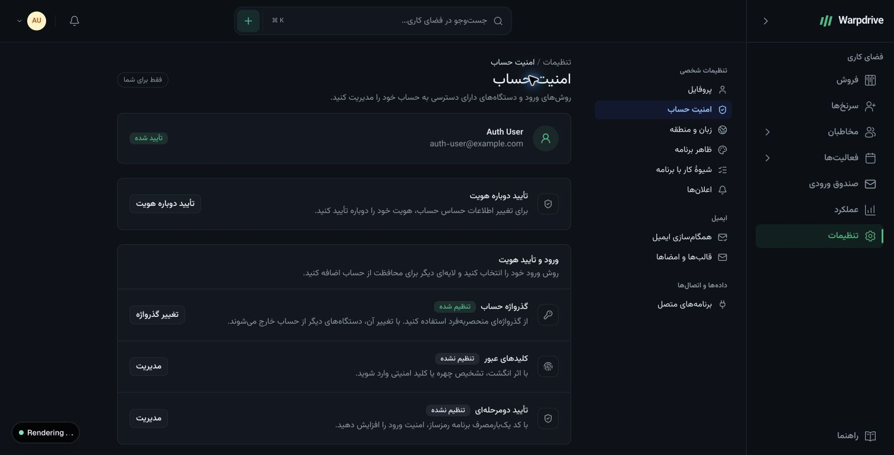
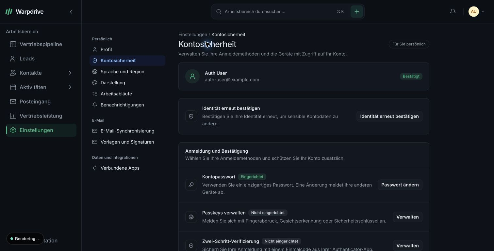
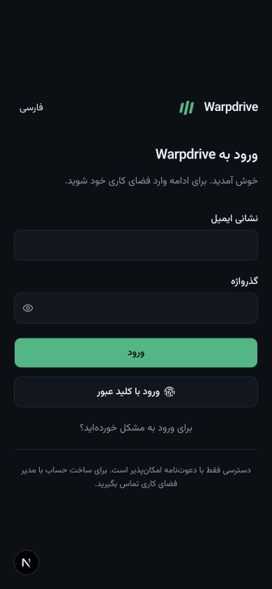

# Authentication interface

The authentication migration retains the existing Warpdrive shell, theme tokens, local typefaces and settings navigation. Personal security and workspace administration have different audiences and remain separate destinations.

## Visual references

Reviewed in Mobbin on 31 October 2026:

- [Attio sign in](https://mobbin.com/screens/0c8aa309-0bf7-4c21-9095-d6f5d0db7ba9): a focused form, clear primary action and restrained secondary methods.
- [Attio profile settings](https://mobbin.com/screens/4103766d-d317-4a33-b1bf-1fe628b4c550): a settings sidebar, readable content column and clear separation between sections.
- [Attio notification settings](https://mobbin.com/screens/ba3cd502-601b-41d5-81c6-f0bda4e69148): concise rows with descriptions and contextual controls aligned at the row end.

These references inform hierarchy and spacing. Warpdrive continues to use its own components, colors, wordmark and interaction patterns. No reference screenshots or third-party assets are bundled with the application.

## Screen structure

| Surface                         | Intended structure                                                                                                                  |
| ------------------------------- | ----------------------------------------------------------------------------------------------------------------------------------- |
| Sign in                         | Quiet branded frame, labeled fields, paired password/passkey actions, one help entry, external providers below when enabled.        |
| Invitation and recovery         | A focused task with the existing account verification and ownership safeguards.                                                     |
| MFA enrollment and confirmation | A focused sequence with setup instructions, code entry and recovery-code acknowledgement. Secrets appear only in the relevant step. |
| Personal security               | Summaries of sign-in methods and protection status, contextual dialogs for changes, readable device and activity rows.              |
| Workspace administration        | Searchable account directory, separate request/delivery/activity views, focused invitation, policy and account-detail dialogs.      |

Actions that change credentials or access retain their existing server validation and confirmation requirements. Presentation changes must not bypass fresh authentication, mandatory MFA, last-method protections or ownership checks.

## Sign-in help

The login page keeps password and passkey actions together, with stacked buttons on narrow screens. The passkey button never submits the password form or requires an email address. External sign-in providers remain separate. Email and password fields retain password-manager support, visible labels and left-to-right credential entry.

One always-available help link opens `/auth/help`. That page offers password reset when passwords are enabled and the existing administrator-assisted recovery request. Saved recovery codes remain at the verification step after primary authentication. Password reset and factor recovery retain different server safeguards; changing a password does not remove MFA.

After two rejected password submissions, the login page also suggests a password reset. Network errors, throttling, cancelled passkey prompts and provider failures do not count. Changing the email address clears the suggestion. This counter exists only in component memory to guide the interface; the server remains responsible for throttling and account protection.

English, Farsi and German use the same workflow. Farsi consistently calls password reset `بازنشانی گذرواژه`, distinct from recovery of account access. Help navigation preserves a validated return destination without placing an email address or credentials in the URL.

The 31 October 2026 refinement passed all 95 authentication unit tests across 27 files, TypeScript, scoped ESLint/Biome and the localization audit. Chrome review covered Farsi and German desktop layouts, Farsi at 390 pixels and German at 320 pixels, with no horizontal overflow in the German mobile login or help page. A synthetic rejected login verified the first- and second-attempt states against the local authentication endpoint. These checks cover the interface refinement; they do not establish deployment or GDPR compliance.

## Review checklist

- Use the existing action color and semantic theme tokens in light and dark themes.
- Keep a clear heading, summary and primary action. Do not expose every editing form on first render.
- Show useful loading, empty, success and failure states without changing the surrounding layout abruptly.
- Keep email addresses, provider identifiers and credential values left to right inside the surrounding Farsi interface.
- Check the Farsi right-to-left layout and the German left-to-right layout with realistic long labels.
- Preserve the user's numbering, calendar and time-zone preferences in device and activity dates.
- Use shared Radix dialogs and tabs for focus management, keyboard navigation and direction support.
- Check small screens for wrapping, usable controls and horizontal overflow. Keep destructive actions distinct from routine actions.
- Review rendered screens in the running app; passing component tests alone does not establish visual quality.

Local review captures are stored outside the repository under the task's `outputs` directory. Automated interaction tests remain beside the components; native authentication protocol tests remain in `src/features/auth/better`.

## Reviewed screens

Captures use synthetic local accounts in the existing dark theme. The Farsi and German
settings retain the current shell; credential forms open only for the selected task.

