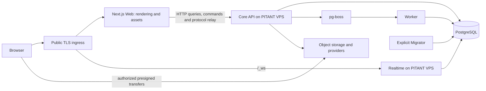

# Independently deployed frontend and self-hosted backend

Web renders the existing Next.js application and calls Core over HTTP. Core owns authentication, PostgreSQL, business commands, provider integrations, file authorization and job production. Worker, Realtime and Migrator keep their existing responsibilities. This is the headless extraction stage; the remaining five DevOps phases, multi-tenancy, SaaS billing and feature monitoring follow separately.



## Frontend runtime

Use `.env.web.example` as the complete frontend configuration inventory. Web needs `CORE_API_ORIGIN` and the shared `CORE_PROXY_TOKEN`, plus its optional build/version metadata. It receives no database, storage, native-auth or provider credentials. Build with `bun run build`; run with `bun run start`. The existing Web image targets build the same presentation. `NEXT_PUBLIC_WS_URL=same-origin` is a build setting; the ingress routes `/_ws` to the existing Realtime process.

The conventional Next.js runtime is the portable deployment target. Cloudflare remains a hosting candidate and needs its own pinned adapter/runtime qualification before use; a successful Next build does not establish Workers compatibility. No new cloud account resources or adapter framework migration are required by this extraction.

Pages use request-scoped HTTP clients and uncached authenticated reads. Existing Server Actions are thin typed command adapters. Their colocated `.backend.ts` implementations run only in Core, through an explicit command allowlist. Core retains each handler's validation, native session, CSRF, permission, fresh-auth and transaction checks. It returns cookie changes as HTTP `Set-Cookie` headers and presentation invalidation separately. Writes use a single request with no automatic retry; read batching remains available.

Protocol, callback, export and binary URLs retain their public paths. Their Next route handlers relay raw bodies, response streams, individual cookies and redirects to the fixed Core origin. Web's `/api/health` and `/api/runtime/web-identity` remain local liveness and identity endpoints. Web's `/api/readyz` checks the configured Core gateway, proxy credential, RPC response and public origin. Core's `/readyz` reports backend readiness.

## Develop Web against a retained Core

Use a compatible non-production Core that already has development data and native accounts. Keep that Core, its database and its migrations fixed while you edit and restart Web. Install the locked application packages and the reviewed Web UI sidecar with Bun 1.4.4.

```sh
bun --no-env-file install --frozen-lockfile
bun --no-env-file scripts/deployment/install-web-ui.mjs
(umask 077 && cp .env.web.example .env.web)
```

In `.env.web`, set `CORE_API_ORIGIN` to the private Core HTTP endpoint and `CORE_PROXY_TOKEN` to the matching transport credential. Set `WEB_PUBLIC_ORIGIN` to Core's `BASE_URL` and open Web through that exact browser-facing origin. For direct local access, use `http://127.0.0.1:3000` for the public origin on both services, `http://127.0.0.1:3010` for the private Core endpoint, and `FRONTEND_TRUSTED_PROXY_HEADER=none`. Use a reachable Realtime WebSocket URL in `NEXT_PUBLIC_WS_URL`, use `same-origin` when development ingress routes `/_ws`, or leave the value empty while working without Realtime.

Keep database, native authentication, storage and provider settings in the backend environment. Next.js loads its standard dotenv files from the checkout, so keep backend settings out of `.env`, `.env.local` and `.env.development*` in the Web checkout. Start the Web development process on loopback.

```sh
bun --no-env-file --env-file=.env.web --bun next dev --webpack --hostname 127.0.0.1 --port 3000
```

Check liveness and Core pairing from a second terminal.

```sh
curl -fsS http://127.0.0.1:3000/api/health
curl -fsS http://127.0.0.1:3000/api/readyz
```

Use a development account to check sign-in and an authenticated page, then edit a presentation component and verify the browser refreshes with the same Core still running. Login and authenticated pages call Core at runtime. Web liveness, identity and isolated component tests are available while Core is offline.

Develop custom screens in the monorepo using the module's UI components, app routes and the existing typed reads and command adapters. Presentation changes can use the retained Core whenever they keep its API contract. New or changed API procedures, permissions and data models need corresponding Core changes and compatibility checks before a Web rollout relies on them.

## Deploy Web alone

Use [the Web-only Compose file](../deploy/images/compose.web.yml) as its own project on the frontend host. Load the qualified AMD64 Web image by its digest and configure `WARPDRIVE_WEB_IMAGE`, `CORE_API_ORIGIN`, `CORE_PROXY_TOKEN` and `WEB_PUBLIC_ORIGIN` in a private frontend environment file. Set `WEB_PUBLIC_ORIGIN` to the same canonical public URL as Core's `BASE_URL`. The project binds port 3000 on loopback by default for a TLS ingress running on that host.

```sh
docker compose --env-file .env.web -p warpdrive-web -f deploy/images/compose.web.yml config --services
docker compose --env-file .env.web -p warpdrive-web -f deploy/images/compose.web.yml up -d --wait --wait-timeout 90 web
```

The rendered service inventory is `web`. The browser calls `/api/trpc` on the public Web origin. The Web server resolves that route and the other backend protocol paths to the fixed private `CORE_API_ORIGIN`. The transport token stays in Web and Core. Authenticated pages and actions require the retained Core. Public ingress routes `/_ws` separately to the retained Realtime process.

Compose waits for local liveness at `/api/health`. Check `/api/readyz` separately before sending traffic to the new image. This also allows Compose to restore older images that expose liveness. A Web process can start and expose its identity before Core is reachable. Readiness returns a safe diagnostic code such as `WEB_READINESS_CORE_UNAUTHORIZED` or `WEB_READINESS_ORIGIN_MISMATCH` when pairing fails. A launch or rollout controller can hold traffic while checking that code. For rollback, restore the previous compatible Web digest in the environment file and repeat the Web-only command.

### Qualification checklist

1. Render and start the Web-only project. Verify the Web image is pinned, runs as its non-root image user and starts as the sole service.
2. Inspect the Web environment for the four presentation settings. Confirm database, storage, provider and native authentication credentials stay in backend services.
3. Verify that Web liveness and identity respond with Core unavailable. Confirm the readiness probe returns a safe failure code and recovers when Core returns.
4. Check the configured upstream pairing. Reject a wrong proxy token and a public origin different from Core's `BASE_URL`.
5. Serve login and an authenticated SSR page through the public origin. Confirm the session cookie survives and the existing CSRF check guards a durable write.
6. Route `/_ws` to Realtime through ingress. Verify the upgrade reaches the ticket check, then verify authenticated delivery and reconnect in the browser rehearsal.
7. Confirm generation-stamped assets and retained generation routing. Check both active and previous slots before removing the previous assets or actions.
8. Exercise the Web upgrade and rollback with the same Core, database, worker, Realtime and migration ledger. Verify the original session and record after both transitions.
9. Pack and read back the five-role v4 bundle. Match immutable image identities and reject missing or inconsistent Core evidence before promotion.
10. Verify Core and Web rollout failures reach authorized Operations history, and retain the sanitized result and teardown evidence from the isolated fixture.

## Backend and ingress

Run the existing Core image/entrypoint with `RUNTIME_COMPONENT=core-api`, its restricted non-owner runtime database role, backend configuration, and `CORE_PROXY_TOKEN`. Core admits its database role and queue, then serves requests while Web is offline. Set optional `CORE_WEB_ORIGIN` to the accepted frontend ingress to enable version reporting. Missing Web identity leaves the frontend version unavailable while Core continues serving other requests. Reuse the existing explicit Migrator for schema changes.

The single-box Compose model includes Core and gives Web only frontend variables. Its source build remains a development path. The image overlay requires `WARPDRIVE_CORE_IMAGE` alongside the existing component image references. The production image workflow publishes the full stack in bundle format v4, with Core, Web, Worker, Realtime and Migrator all required. The Web-only workflow publishes the standalone Web archive for the headless ingress and retained Core. Historical bundles remain readable for their original qualification records. The private Core overlay remains available for installations using separate network admission settings.

For a separately hosted frontend, use HTTPS to a fixed backend gateway protected by the shared proxy credential. Generate at least 32 base64url characters, for example `openssl rand -hex 32`; configure the same value on Web and Core. Keep the backend listener private behind that gateway. Core validates the proxy credential before restoring the public host and client IP; it still derives user authority from the actual native session cookie. Never put this token in a `NEXT_PUBLIC_` variable.

Set `FRONTEND_TRUSTED_PROXY_HEADER=x-real-ip` only behind an ingress that overwrites that header; the supplied Caddy configuration does so. Use `cf-connecting-ip` only behind verified Cloudflare ingress, or `none` for direct local access. Core restores the validated IP for the existing auth limiter. The token grants transport access, not a user identity or permission. Preserve the public `BASE_URL`, OAuth callback URLs and host-only Secure cookies. Keep object-storage URLs browser-reachable for presigned transfers.

The public ingress must route `/_ws` to Realtime independently of Web hosting. A remote backend gateway also needs that WebSocket route when used as its upstream. Provider webhooks continue through the same public protocol relay; signatures are checked against the original bytes by their existing backend handlers.

## Version and rollout compatibility

Use the isolated headless final-image smoke to exercise Core startup before Web. The standby Core used by the Web-only workflow is the published 1.8.1 image and needs Web identity at startup. Once that Core is ready, the workflow checks that it remains ready and serves the private configuration API during both Web replacements. The five-role workflow separately exercises cold startup with the candidate Core and Web absent.

Web declares its own bundled version and source revision; Core does not substitute its own version for Web. Deploy the backend command/projection additions before switching frontend traffic. Retain the previous compatible frontend assets and existing generation routing for open browsers, using the installation's established retention policy. Do not remove old action or backend contracts during the switch. Roll back the frontend to its retained compatible generation through the existing release path.

## Qualify a Web image for an independent rollout

Run **Headless Web image qualification** from canonical `main`. It builds the
single Web image from that commit and exercises it on disposable PostgreSQL
with the pinned retained Core 1.8.1 image. The fixture signs in to the retained
Web 1.8.2 image, switches to the candidate, then restores the exact 1.8.2 image.
It checks the existing session, durable data and authenticated Inbox across
both transitions. It also verifies that Core, PostgreSQL, Worker and Realtime
keep their container identities and start times, and that the migration ledger
stays intact. Pull request rehearsals produce separate artifacts for review.

```bash
gh workflow run headless-web-qualification.yml -R KhademOHAli1/warpdrive --ref main
```

The workflow retains `web-image.tar`, its checksum, the archive identity and
the native smoke report. Verify the ZIP size and digest from the GitHub artifact
record, then match the report to the selected Web revision and retained Core.
The archive binds the smoke-tested image config to the OCI manifest digest used
by the installed Docker engine. Use that manifest digest when staging the image.
The default transport uses the original retained Core and Web Actions artifacts
while they are available, then reads the same bytes from private OCI custody.
To retain the original ZIPs, run **Headless deployment input artifact custody**
with `mode=retain` while the Actions artifacts are available. The default
`mode=observe` verifies their immutable private copies.

Stage Web on the existing ingress and private Core link. Check its exact
identity, public login rendering, protected redirects and relay to Core before
switching traffic. Preserve the existing Core, Worker, Realtime and PostgreSQL
process witnesses across the switch. Verify the persisted route, public identity,
Realtime upgrade and previous stamped browser assets after the switch.

Keep the previous Web generation ready for rollback. Restore the prior default
route through the relay's compare-and-swap operation and preserve stamped routes
for existing tabs. Verify the restored default and asset availability. A Web
rollback changes frontend routing only.

[The 1.8.2 rollout record](deployment-evidence/headless-web-rollout-20261120.json)
links the exact hosted checks and installed readback. The 1.8.2 Web image went
live with the same 1.8.1 Core process and retained service witnesses. Realtime
and the retained 1.7.2 and 1.8.1 assets passed public readback.
