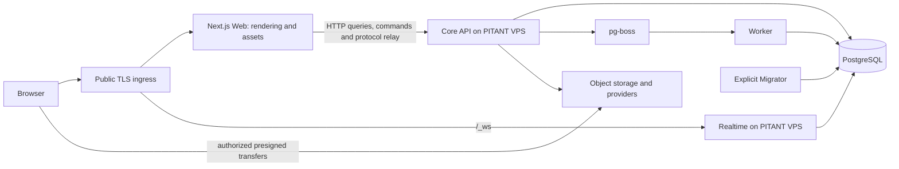

# Independently deployed frontend and self-hosted backend

Web renders the existing Next.js application and calls Core over HTTP. Core owns authentication, PostgreSQL, business commands, provider integrations, file authorization and job production. Worker, Realtime and Migrator keep their existing responsibilities. This is the headless extraction stage; the remaining five DevOps phases, multi-tenancy, SaaS billing and feature monitoring follow separately.



## Frontend runtime

Use `.env.web.example` as the complete frontend configuration inventory. Web needs `CORE_API_ORIGIN` and the shared `CORE_PROXY_TOKEN`, plus its optional build/version metadata. It receives no database, storage, native-auth or provider credentials. Build with `bun run build`; run with `bun run start`. The existing Web image targets build the same presentation. `NEXT_PUBLIC_WS_URL=same-origin` is a build setting; the ingress routes `/_ws` to the existing Realtime process.

The conventional Next.js runtime is the portable deployment target. Cloudflare remains a hosting candidate and needs its own pinned adapter/runtime qualification before use; a successful Next build does not establish Workers compatibility. No new cloud account resources or adapter framework migration are required by this extraction.

Pages use request-scoped HTTP clients and uncached authenticated reads. Existing Server Actions are thin typed command adapters. Their colocated `.backend.ts` implementations run only in Core, through an explicit command allowlist. Core retains each handler's validation, native session, CSRF, permission, fresh-auth and transaction checks. It returns cookie changes as HTTP `Set-Cookie` headers and presentation invalidation separately. Writes use a single request with no automatic retry; read batching remains available.

Protocol, callback, export and binary URLs retain their public paths. Their Next route handlers relay raw bodies, response streams, individual cookies and redirects to the fixed Core origin. Web's `/api/health` and `/api/runtime/web-identity` remain local liveness and identity endpoints. Core's `/readyz` reports backend readiness.

## Backend and ingress

Run the existing Core image/entrypoint with `RUNTIME_COMPONENT=core-api`, its restricted non-owner runtime database role, backend configuration, `CORE_PROXY_TOKEN` and `CORE_WEB_ORIGIN`. The latter points to the accepted frontend ingress; its metadata endpoint is independent of Core, avoiding a startup cycle. Reuse the existing explicit Migrator for schema changes.

The single-box Compose model now includes Core and gives Web only frontend variables. Its source build remains a development/convenience path. The image overlay requires `WARPDRIVE_CORE_IMAGE` alongside the existing component image references. The separate private-network Core overlay remains available for installations that already use its digest and network admission settings.

For a separately hosted frontend, use HTTPS to a fixed backend gateway protected by the shared proxy credential. Generate at least 32 base64url characters, for example `openssl rand -hex 32`; configure the same value on Web and Core. Keep the backend listener private behind that gateway. Core validates the proxy credential before restoring the public host and client IP; it still derives user authority from the actual native session cookie. Never put this token in a `NEXT_PUBLIC_` variable.

Set `FRONTEND_TRUSTED_PROXY_HEADER=x-real-ip` only behind an ingress that overwrites that header; the supplied Caddy configuration does so. Use `cf-connecting-ip` only behind verified Cloudflare ingress, or `none` for direct local access. Core restores the validated IP for the existing auth limiter. The token grants transport access, not a user identity or permission. Preserve the public `BASE_URL`, OAuth callback URLs and host-only Secure cookies. Keep object-storage URLs browser-reachable for presigned transfers.

The public ingress must route `/_ws` to Realtime independently of Web hosting. A remote backend gateway also needs that WebSocket route when used as its upstream. Provider webhooks continue through the same public protocol relay; signatures are checked against the original bytes by their existing backend handlers.

## Version and rollout compatibility

Web declares its own bundled version and source revision; Core does not substitute its own version for Web. Deploy the backend command/projection additions before switching frontend traffic. Retain the previous compatible frontend assets and existing generation routing for open browsers, using the installation's established retention policy. Do not remove old action or backend contracts during the switch. Roll back the frontend to its retained compatible generation through the existing release path.

## Qualify a Web image for an independent rollout

Run **Headless Web image qualification** from canonical `main`. It builds the
single Web image from that commit and exercises it on disposable PostgreSQL
with the pinned retained Core image. The fixture covers native login,
authenticated inbox rendering, a durable write and clean shutdown. Pull request
rehearsals produce separate artifacts for review.

```bash
gh workflow run headless-web-qualification.yml -R KhademOHAli1/warpdrive --ref main
```

The workflow retains `web-image.tar`, its checksum, the archive identity and
the native smoke report. Verify the ZIP size and digest from the GitHub artifact
record, then match the report to the selected Web revision and retained Core.
The archive binds the smoke-tested image config to the OCI manifest digest used
by the installed Docker engine. Use that manifest digest when staging the image.
The default transport uses the original retained Core Actions artifact while
it is available, then reads the same bytes from private OCI custody. To retain
the original Core and Web ZIPs, run **Headless deployment input artifact custody**
with `mode=retain` while the Actions artifacts are available. The default
`mode=observe` verifies their immutable private copies.

Stage Web on the existing ingress and private Core link. Check its exact
identity, public login rendering, protected redirects and relay to Core before
switching traffic. Preserve the existing Core, Worker, Realtime and PostgreSQL
process witnesses across the switch. Verify the persisted route, public identity,
Realtime upgrade and previous stamped browser assets after the switch.

Keep the previous Web generation ready for rollback. Restore the prior default
route through the relay's compare-and-swap operation and preserve stamped routes
for existing tabs. Verify the restored default and asset availability. A Web
rollback changes frontend routing only.

[The 1.8.2 rollout record](deployment-evidence/headless-web-rollout-20261120.json)
links the exact hosted checks and installed readback. The 1.8.2 Web image went
live with the same 1.8.1 Core process and retained service witnesses. Realtime
and the retained 1.7.2 and 1.8.1 assets passed public readback.
