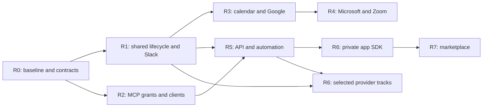

# Integration, MCP and app-platform project plan

Version 1.0, 2026-10-31. Status: proposed execution plan, documentation only.

This plan turns the integration programme into **446 future tasks across 23 work packages**.
It preserves the completed local work and sets observable delivery milestones for Slack,
secure MCP clients, calendar providers, developer integrations and the later marketplace.
All new tasks are planned. Creating this plan does not start their implementation.

## Plan files

- [Detailed task register](integration-platform-tasks.md): checkboxes, task IDs, acceptance criteria and verification methods.
- [Task import CSV](integration-platform-tasks.csv): the same tasks with priorities, role owners, dependencies, stages and estimate fields.
- [Machine-readable summary](integration-platform-plan-summary.json): counts, work packages, dependency graph and package exit criteria.
- [Existing platform overview](integration-platform-plan.md): scope and earlier work-package identifiers retained for prior handoffs.
- [Completed UI refinement](integration-ui-polish.md) and [foundation report](integration-platform-report.md): historical implementation and evidence.

The Markdown register and CSV are matching starting snapshots. If tasks are imported into
an issue tracker, record that tracker here and make it the execution-status source. Do not
maintain contradictory live completion counts in a dated export.

## Current baseline

Planning inspected the local main/auth checkout at `8539fe8` and the isolated integration
branch at `e321126f98a37a376e72ab0e4513e0c5b003f2b5`. These are local observations, not a
claim that GitHub or parallel development has stopped changing. BASE rechecks them before code work.

| Area                  | Verified baseline                                                                                                                 | Remaining boundary                                                                                                                          |
| --------------------- | --------------------------------------------------------------------------------------------------------------------------------- | ------------------------------------------------------------------------------------------------------------------------------------------- |
| Connections UI        | Eight refinement commits, 21 individual catalog entries, local provider marks and FA/DE/EN screens.                               | A directory entry is not evidence of an implemented provider.                                                                               |
| Slack                 | Source implements admin OAuth, encrypted token storage, joined-public-channel selection, checks and revocation retry.             | No real Slack installation, token-rotation support, notification rules or inbound action qualification yet.                                 |
| MCP                   | Existing CRM tools, structured results, action hints, resource audience checks and refreshable-grant visibility.                  | Fine-grained client capabilities, broader protocol/domain coverage and cross-host qualification remain.                                     |
| Client packages       | ChatGPT and Claude package generator plus meeting, pipeline and draft workflow instructions.                                      | Generated files have not established installation, vendor approval or rich-view support in real hosts.                                      |
| Mail/calendar         | Existing Gmail workflows and calendar UI; detailed Google Calendar event specification is documented.                             | Multi-account policy, common sync semantics and the new calendar/conferencing providers need implementation and qualification.              |
| Background work       | `src/server/worker.ts` already registers pg-boss jobs for mail, reminders, import and other functions.                            | Audit and extend this system and reconcile parallel workflow work; do not create a second queue by assumption.                              |
| Local runtime         | Preview is isolated on loopback port 3150 with a separate database.                                                               | The separate realtime service was not qualified in the UI pass; BASE includes complete service startup.                                     |
| Existing verification | At the UI refinement head: production build, 89 focused unit tests and 43 integration tests passed; type/lint/i18n checks passed. | Those results apply to that source head. This documentation-only change validates plan structure and formatting, not a new runtime release. |
| Marketplace/app SDK   | Roadmap preview and proposed capability inventory.                                                                                | No untrusted app runtime, operational store or public distribution has been delivered.                                                      |

The existing preview is completed work, not counted among the 446 new tasks. No live provider
connection, public domain, network tunnel or marketplace publication is assumed. Local development
and simulated-provider testing continue under the user's local-preview choice.

## Product outcomes

1. A CRM event produces a configured, permission-aware Slack notification with preview, delivery history and recovery.
2. A connected AI client receives an explicit grant. Read-only access cannot mutate through tools, direct calls or embedded UI; revocation and role changes take effect server-side.
3. Users can complete supported calendar and conferencing workflows in Farsi and German, including Iranian-calendar display and explicit recurrence/sync limits.
4. New providers reuse connection ownership, credentials, resource selection, refresh, jobs, health, audit and revocation contracts.
5. Developers can build an isolated private extension with authorized data, workflow, UI and MCP capabilities, then update and remove it safely.
6. Marketplace discovery leads to a working permission-review and installation lifecycle with identifiable publishers and accurate compatibility/support claims.

Capability parity with Twenty's integration and extension ecosystem is the comparison target.
This programme does not claim parity for every unrelated CRM feature.

## Working constraints and proposed defaults

- Preserve the current Warpdrive shell, shadcn adapters, layout tokens and existing auth workflows. Use Mobbin to research new journeys and document the chosen patterns before major UI work.
- Farsi is the first design and copy-review language; German and English ship in the same feature's acceptance gate. Translation, errors and operator instructions are part of implementation.
- Keep language, numbering, calendar and time zone independent. Calendar wire/storage formats must not depend on display language.
- Honor the declared Bun version and lockfile. The app runtime, SDK and proposed extension execution target must be Bun-compatible.
- Preserve the single-tenant self-hosted product. Separate personal/shared connection ownership without quietly introducing a different SaaS tenancy architecture.
- Reuse pg-boss, current permission checks, Better Auth verification and any existing workflow/event implementation after inventory.
- Use one shared capability vocabulary for integrations, MCP, API clients and application roles. Tool annotations and client instructions are explanatory, not permission enforcement.
- Keep private credentials, runtime configuration and database dumps outside Git and public artifacts. Retain provider-asset provenance.
- Keep the existing upstream relationship and protect parallel development. Reconciliation, push, merge, deployment and publication are separate actions, not side effects of writing a plan.

## Delivery milestones

Milestones describe reviewable outcomes, not promised calendar dates. Each requires the shared
quality gate and the relevant work-package exit criteria. Work can overlap where dependency and
ownership boundaries permit; release labels do not require a second implementation of shared systems.

| Milestone | Reviewable outcome                                                | Principal packages                              | Exit demonstration                                                                                                                                                 |
| --------- | ----------------------------------------------------------------- | ----------------------------------------------- | ------------------------------------------------------------------------------------------------------------------------------------------------------------------ |
| R0        | Reconciled baseline and agreed contracts.                         | BASE, ARCH; start UX/QA/OPS/OSS.                | Reproduce the current app and tests from an isolated checkout, identify existing workflow ownership, and review architecture/permission decisions.                 |
| R1        | Useful Slack notifications on reliable shared infrastructure.     | CONN, EVT, SLK.                                 | Create/update a synthetic deal, match a rule, preview a safe Slack message, simulate delivery, inspect history, then exercise failure and revocation recovery.     |
| R2        | Secure, useful MCP and client experiences.                        | AISEC, MCP, CLIENT.                             | Complete client-simulator consent; demonstrate read-only denials, approved writes, refresh/revoke, localized workflows and supported rich-view/text fallback.      |
| R3        | Mail/calendar foundations and Google Calendar/Meet.               | MAIL, CAL, GOOG.                                | Create/edit/cancel and synchronize synthetic events, including all-day dates, recurrence, guests, conflicts and conference lifecycle in FA/DE.                     |
| R4        | Microsoft 365/Teams and Zoom.                                     | MS, ZOOM.                                       | Demonstrate each supported provider workflow and its ownership, entitlement and failure behavior independently.                                                    |
| R5        | Supported developer integrations and advanced Slack interaction.  | API, AUTO, SLKX.                                | Use scoped REST/GraphQL clients, signed events and automation steps; verify a signed user-initiated Slack action cannot exceed CRM access.                         |
| R6        | Independent provider tracks and privately installed applications. | EXP, SDK.                                       | Ship selected providers independently and install/update/disable/uninstall a reference private app in real isolation.                                              |
| R7        | Operational marketplace and public distribution, when chosen.     | STORE plus applicable OPS/QA/OSS release gates. | Review app permissions, install/configure, review an update, recover a failed migration and remove the app; public hosting/publication require their own evidence. |
| CROSS     | Quality, localization, operations and maintenance throughout.     | UX, OPS, QA, OSS.                               | Every milestone includes current localized workflows, tests, diagnostics, recovery and documented support boundaries.                                              |

The graph shows major dependencies. Package-level prerequisites are in the task register and
CSV. R2 engineering can proceed after ARCH while R1 is developed. Extra providers do not block
MCP or the app SDK just because they share a later release label.

## First execution batch

Start with BASE, not more catalog entries. The first batch should produce evidence and a sized
implementation slice without changing provider grants or exposing the local app.

1. BASE-001 to BASE-004: identify current repository ownership, parallel workflow work, the eight UI commits and the isolated integration branch.
2. BASE-005 to BASE-007: confirm Bun/dependencies and map the queue/event and authorization/account seams.
3. BASE-008 to BASE-010: establish isolated services, include worker/realtime, and capture a passing current baseline.
4. BASE-011 to BASE-012: save restoration evidence and size the first vertical slice using actual findings.
5. ARCH-001 to ARCH-007: define installation/grant ownership, capabilities, lifecycle and delivery semantics.
6. UX-001 to UX-004 and QA-001 to QA-004: map the full journeys, define truthful states and prepare reusable fixtures/contracts.
7. Begin CONN and EVT under those contracts; deliver SLK through its complete local demonstration before adding more destinations.

BASE is a dependency on a fresh inventory, not a request to stop all other work or overwrite
an active branch. Future tasks remain unstarted until execution is actually selected.

## Priority, ownership and estimation

| Priority | Meaning within its milestone                                                                         |
| -------- | ---------------------------------------------------------------------------------------------------- |
| P0       | Foundation, authorization, data correctness or verification required for the relevant delivery gate. |
| P1       | Core supported workflow needed for the principal product milestone.                                  |
| P2       | Expansion or developer/ecosystem capability after its prerequisites.                                 |
| P3       | Later provider tracks with product/vendor decisions still open.                                      |

The starting register contains **190 P0, 170 P1, 66 P2 and 20 P3 tasks**. A P0 in a later or
cross-cutting track does not mean every P0 task must precede the first Slack demonstration.
Use milestone scope and dependencies together rather than sorting the whole project by priority alone.

Responsibility labels describe skill/ownership boundaries: platform, integrations, security,
calendar/mail domain owners, workflows, design/localization, QA, operations and maintainers.
They are not commitments from named people or assumptions about staffing. One person may cover
several roles, with one active vertical slice per implementation owner and explicit review boundaries.

Task estimates are deliberately `unestimated`. BASE-012 supplies the first ranges after the
current-code audit. Size tasks with implementation, tests, localization, review and operational
work included; split uncertain isolation/provider work into bounded spikes before committing dates.
Provider approval, account entitlements and public review lead times are tracked separately from
engineering effort. Re-estimate after R1 and after the first real calendar synchronization.

## Work-package map

| Packages                      | Primary responsibility and likely code boundary                                                                                                   |
| ----------------------------- | ------------------------------------------------------------------------------------------------------------------------------------------------- |
| BASE / ARCH                   | Repository/handoff inventory and architecture decisions; all implementation paths are rechecked against current main.                             |
| CONN / SLK / SLKX / EXP       | `src/features/integrations`, provider adapters, service DTOs and connection schema.                                                               |
| EVT / AUTO                    | Existing jobs, domain mutation hooks and whichever workflow implementation the baseline audit establishes as authoritative.                       |
| AISEC / MCP / CLIENT          | `src/features/oauth`, `src/features/mcp`, package builder and shared authorization checks.                                                        |
| MAIL / CAL / GOOG / MS / ZOOM | Existing email/activity/calendar domains plus provider adapters; do not duplicate temporal or mailbox ownership rules.                            |
| API                           | Authorized public interfaces and typed clients over existing domain services.                                                                     |
| SDK / STORE                   | New extension/marketplace modules behind the shared capability, provider and event contracts; exact directories follow the architecture decision. |
| UX / QA / OPS / OSS           | Feature-owned catalogs/tests and reviewed shared UI, service startup, evidence, developer and operator documentation.                             |

## Definition of done

A future task may be checked off only when its own acceptance criterion and verification are
satisfied at the appropriate stage. A code commit, a generated package and a successful provider
installation are distinct outcomes.

For ordinary local implementation tasks:

- The intended behavior and relevant regressions have tests written first and observed failing for the right reason.
- Server boundaries validate inputs; operational failures use the project's Result/error conventions; I/O has bounded time and cancellation.
- Data, ownership and concurrency behavior use real PostgreSQL tests; upstream provider responses can be simulated explicitly.
- Permissions apply at request, job and embedded-action boundaries. Secrets and unauthorized fields stay out of DTOs, logs and snapshots.
- New or changed user/operator workflows include natural FA/DE/EN copy, Iranian-calendar cases where relevant, keyboard behavior and responsive review.
- The current build, type, lint, i18n and relevant UI/provider tests pass on the exact source head.
- Schema changes include upgrade/recovery tests; provider behavior includes outage, expiry, duplicate and revocation cases appropriate to that feature.
- Evidence records the head, commands, results, supported profile and unresolved limits. Documentation and the capability map agree with behavior.

For live-provider, public-hosting and publication tasks, completion additionally requires the
actual selected environment/client/account and its finite acceptance scenario. Local fixtures
cannot close those tasks. Current local development does not depend on choosing a public domain.

## Common provider acceptance checklist

Every released provider must close the applicable items, not merely complete OAuth:

- Correct provider, upstream account identity, connection owner and personal/shared scope.
- Clear server prerequisites, account selection and reviewed provider permissions.
- Validated resource selection, stable IDs and updated display names.
- Safe credential storage, refresh/rotation, expiry, scope changes and reauthorization.
- Real supported data/actions, bounded paging/sync, version/conflict behavior and loop prevention.
- Durable jobs, retries, rate limits, unknown outcomes, cancellation and diagnostic history.
- Permission checks before data exposure and immediately before delayed external effects.
- Clear pause/reconnect/disconnect, local credential block and remote revocation recovery.
- Explicit imported-data, app-data and already-sent-content retention behavior.
- FA/DE/EN onboarding, errors, confirmation, recovery, dates and mobile/keyboard review.
- Provider contract tests, PostgreSQL tests and a separate actual-provider support record.
- Operator setup, upgrade, troubleshooting and revocation instructions.

## Verification and release stages

| Stage flag       | What can close it                                                                                    | What it does not establish                                  |
| ---------------- | ---------------------------------------------------------------------------------------------------- | ----------------------------------------------------------- |
| `local`          | Relevant source, real-DB, simulator and browser evidence.                                            | A real provider grant or public deployment.                 |
| `decision`       | A documented selected vendor/product decision and acceptance contract.                               | Implementation or installation.                             |
| `live-provider`  | Approved finite tests on the named actual provider/client profile.                                   | Every account tier, host version or production environment. |
| `public-hosting` | Qualification of the selected reachable environment, configuration and operational recovery.         | Marketplace or vendor publication.                          |
| `publication`    | The selected artifact is published to the named destination with version/provenance/support records. | Correctness of every future update or compatibility claim.  |

There are **411 local tasks, 3 decision tasks, 24 live-provider tasks, 4 public-hosting tasks and
4 publication tasks**. Stage is separate from priority and execution status. All are currently
planned, not actively blocked. Only the applicable later stage waits for its external prerequisites.

Before claiming a supported release, combine the feature's gate with applicable UX, QA, OPS and
OSS checks. Do not treat all cross-cutting package tasks as a single final waterfall phase.

## Proposed decision log

These defaults make the plan concrete. Record the actual choice and owner before implementing
a dependent contract; routine local implementation decisions can follow the chosen defaults.

| Decision                                 | Proposed default                                                                                                                     | First affected work          |
| ---------------------------------------- | ------------------------------------------------------------------------------------------------------------------------------------ | ---------------------------- |
| Connection ownership                     | Personal accounts stay personal; administrator-managed shared connections have explicit delegated-use rules.                         | ARCH-002 / CONN.             |
| AI grants                                | New clients start with explicit minimal/read-only capabilities; write capabilities require clear consent.                            | AISEC-002 to AISEC-008.      |
| Slack payloads                           | Generic link-only by default, with an explicit field allowlist and destination disclosure policy for richer messages.                | SLK-002 / SLK-017.           |
| First notification demo                  | Deal stage change, then deal creation and activity-related rules through the same delivery path.                                     | SLK-001 / SLK-009 / SLK-010. |
| Iranian recurrence                       | Preserve native semantics; reject or explain mappings that cannot round-trip losslessly until a reviewed alternative is implemented. | CAL-004 / GOOG-010.          |
| Untrusted app runtime                    | Bun-compatible code in a real OS/container boundary, with brokered access and explicit resource/egress limits.                       | ARCH-009 / SDK-008 onward.   |
| App distribution order                   | Private reference apps and a proven lifecycle precede public marketplace intake.                                                     | SDK / STORE.                 |
| Domain and live grants                   | Keep the current preview local. Supply the deployment and provider test resources only when their later stage is selected.           | OPS-014 to OPS-016.          |
| Additional provider order                | Google Calendar/Meet, Microsoft/Teams and Zoom lead; other adapters are selected independently by user value and readiness.          | GOOG / MS / ZOOM / EXP.      |
| Telephony/accounting/e-signature vendors | Leave unselected; compare target-user workflows, APIs, region/account support and licensing before implementing.                     | EXP-041 / EXP-045 / EXP-049. |

## Twenty comparison and traceability

The following is a **dated capability comparison**, not a claim that every Twenty feature has
been implemented or that its architecture should be copied. The target choices in this plan are
our proposed implementation strategy.

| Capability reference                                                                                                                                                          | Warpdrive baseline                                                             | Planned path                                                              |
| ----------------------------------------------------------------------------------------------------------------------------------------------------------------------------- | ------------------------------------------------------------------------------ | ------------------------------------------------------------------------- |
| Google/Microsoft mail, multiple mailboxes and calendar context. [Twenty mail/calendar](https://docs.twenty.com/getting-started/core-concepts/calendar-and-email).             | Gmail exists; provider breadth and account policy remain incomplete.           | MAIL, CAL, GOOG, MS.                                                      |
| REST/GraphQL APIs, webhooks and external automation. [Twenty integrations](https://docs.twenty.com/getting-started/core-concepts/calendar-and-email).                         | Internal APIs and jobs exist; supported public contracts remain work.          | API, AUTO, EVT.                                                           |
| Record/manual/schedule/webhook triggers, variables and workflow actions. [Twenty workflows](https://docs.twenty.com/getting-started/core-concepts/workflows).                 | Existing jobs and parallel workflow work require reconciliation.               | BASE-004, EVT, AUTO.                                                      |
| Reusable connection providers with personal/shared ownership and setup prerequisites. [Twenty connections](https://docs.twenty.com/developers/extend/apps/logic/connections). | Slack-specific foundation and Gmail controls.                                  | ARCH, CONN, provider tracks.                                              |
| Application-defined data, logic, UI, views and AI capabilities. [Twenty apps](https://docs.twenty.com/getting-started/core-concepts/apps).                                    | No operational app SDK/runtime.                                                | SDK, MCP, CLIENT.                                                         |
| Isolated execution and permission-scoped extension access. [Twenty execution model](https://docs.twenty.com/getting-started/core-concepts/apps).                              | Core runtime uses Bun; an untrusted-app isolation boundary is not implemented. | ARCH-009 and SDK isolation/bridge work; the Bun target is our constraint. |
| Private/public app publishing, ownership and version compatibility. [Twenty publishing](https://docs.twenty.com/developers/extend/apps/operations/publishing).                | Marketplace is explicitly planned.                                             | SDK, STORE, OSS.                                                          |

Sources were checked on 2026-10-31. Recheck provider/host documentation during implementation and
before release, particularly entitlements, supported UI extensions and package/authorization formats.

For client and protocol work, the current references distinguish packages, skills, MCP and optional
interfaces in [OpenAI's plugin documentation](https://developers.openai.com/plugins), the separate
[Claude Code manifest profile](https://code.claude.com/docs/en/plugins-reference), and the
[MCP authorization specification](https://modelcontextprotocol.io/specification/2026-07-28/basic/authorization).
The inspected MCP profile includes client metadata and legacy registration considerations; ARCH/AISEC
must evaluate actual installed-library and client compatibility before changing the existing server.

Calendar work additionally follows the existing [Google Calendar event workflow](google-calendar-event-workflow.md).
Mobbin references and existing visual decisions remain in [the UI research notes](integration-ui-research.md).

## Risks and dependencies to retire

| Open condition                                                 | Consequence                                                      | Planned response                                                                                    |
| -------------------------------------------------------------- | ---------------------------------------------------------------- | --------------------------------------------------------------------------------------------------- |
| Parallel branches or newer UI/workflows are not reconciled.    | Changes can reintroduce an old shell or duplicate an engine.     | BASE inventory and isolated integration before feature work.                                        |
| Current grants are broader than a future minimal client grant. | The UI could imply restrictions that are not enforced.           | AISEC migration, consent and negative tests before minimal-scope claims.                            |
| Job enqueue or provider response fails at an ambiguous point.  | Lost intent, duplicate side effects or misleading status.        | Transactional outbox, idempotency, unknown outcomes and bounded repair.                             |
| Slack channel audience differs from CRM visibility.            | A valid bot grant could disclose private CRM context.            | Minimal payloads, explicit data policy and execution-time authorization.                            |
| Provider token/permission/subscription behavior changes.       | Refresh, sync or callbacks can stop functioning.                 | Pinned compatibility records, renewal jobs, contract tests and live gates.                          |
| Iranian recurrence cannot be represented by a provider.        | Display conversion alone could hide changed recurrence meaning.  | CAL semantic decision, round-trip tests and explicit unsupported cases.                             |
| App code shares too much host authority.                       | Extension permissions would not be a real boundary.              | Brokered APIs and measured OS/container isolation before untrusted installation.                    |
| App update changes permissions or schema.                      | Silent scope expansion, data loss or a broken installation.      | Permission diffs, migration review, version pinning and tested recovery.                            |
| Vendor review, domain or test accounts are unavailable.        | Live-provider/publication tasks cannot be qualified.             | Continue local work; track external lead times independently and make no unsupported release claim. |
| Natural copy or accessible behavior is postponed.              | FA/DE users receive incomplete workflows despite valid catalogs. | Locale/keyboard/browser evidence in each milestone's definition of done.                            |
| Runtime worker/realtime services are missing.                  | A UI can look complete while background behavior never runs.     | BASE service smoke and OPS readiness/worker recovery.                                               |

## Maintenance of this plan

Before an execution batch, confirm the source head, selected milestone, ownership and dependencies.
After a batch, attach evidence to the actual acceptance criteria, update the execution tracker and
record any scope/dependency change. Preserve task IDs; split oversized items with child issues rather
than silently marking them complete. Review the parity matrix at each public release because its
external reference can change independently of this repository.

No deadlines, provider approvals, domain selection, public publication or implementation beyond the
completed preview are implied by this planning snapshot.
