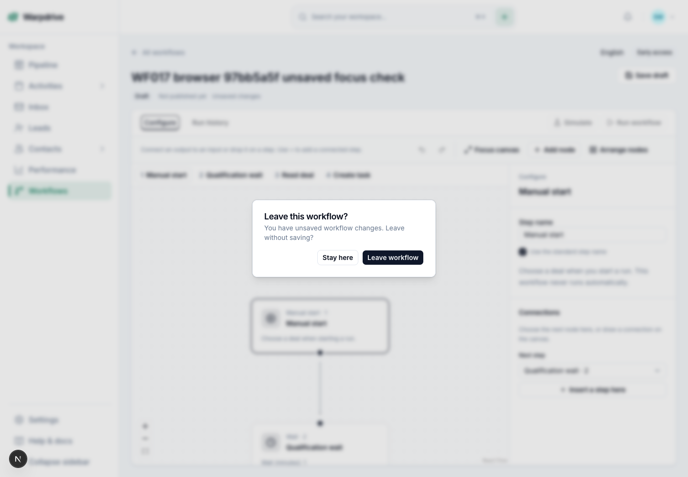

# Workflow draft navigation qualification — 2 November 2026

Issue [#674](https://github.com/KhademOHAli1/warpdrive/issues/674) remains broader than this increment. The actual development app at `cc6268266885f215e357d440523e9f9dec9cb0a1` lost an edited workflow name when the user followed **All workflows** and reopened it: neither a native nor an in-app confirmation appeared.

The editor now opens the existing themed confirmation when a same-tab application link would leave a dirty draft or an operation in progress. **Stay here** and Escape keep the draft and current history entry. **Leave workflow** replays the original unchanged link once through its normal navigation handler. Acknowledged saves and undo-to-clean remove the guard; failed saves retain it. The pending-operation message states that leaving will not cancel the operation. New-tab, modified, download, same-page fragment and external links retain their existing behavior.

The [sanitized qualification record](navigation-qualification-2026-11-02.json) binds the six changed source files to these actual checks:

- 21 focused unit checks, including the actual editor and confirmation dialog.
- 14 native-browser journey checks: native password HTTP sign-in and secure session/CSRF, create, insert between steps, undo/redo, edit, arrange/zoom/fit, save, cancel/confirm departure, library reopen and cold reload.
- 11 independent real PostgreSQL checks: the saved four-node graph and positions, exact edges/bindings, custom step name, non-admin permissions, and no publication or execution rows.
- Seven further hydrated-browser checks covering safe initial focus, Escape/focus return, preserved dirty text, actual zoom and Farsi RTL/authored text. Synthetic desktop and mobile screenshots were visually reviewed.

The app used Bun 1.4.4, an owned HTTPS loopback origin and a disposable PostgreSQL 16 database migrated through canonical `0098`. No authentication session or CSRF cookie was fabricated. All owned browser contexts, processes and the database container were closed; foreign resources were retained and private credentials, environment and TLS key were deleted.

The first browser allocation stopped after the valid baseline proof because its conservative app-only memory guard reserved the entire database cap. A follow-up focus attempt timed out before waiting for hydrated dirty UI; both attempts remain disclosed. The modified journey and its explicit readiness-qualified follow-up passed under the fresh finite allocation. Sampled aggregate memory stayed below 8 GiB; this is not a continuously measured peak claim.

Browser Back/Forward, pointer pan/drag/reconnect, named condition branches, keyboard graph undo/redo, publishing, workflow execution/recovery and live providers remain outside this browser slice. The existing document-unload guard remains. These results do not close all of WF-017, establish human acceptance, or authorize a release or deployment. Exact resulting-main CI is a separate publication gate.
