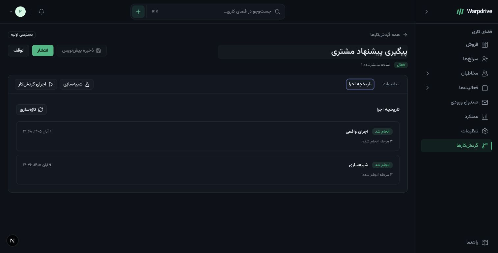
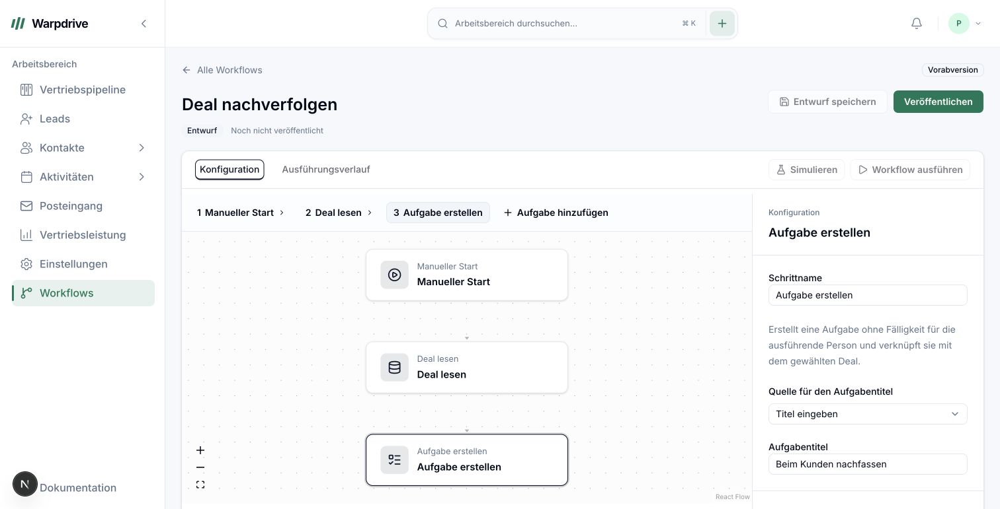
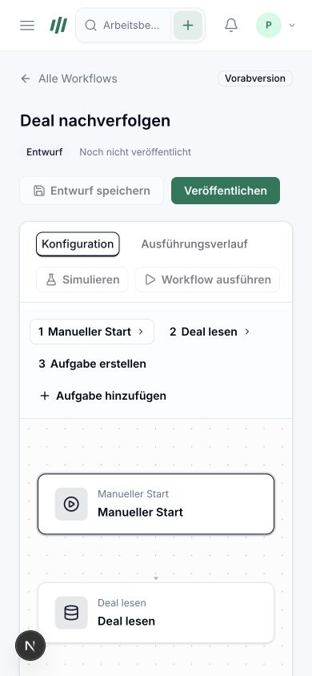

# Manual workflow UI review

Captured 31 October 2026 from the working implementation on the merged Better Auth
baseline. These are synthetic local previews, not customer data or deployed acceptance.

The current application shell, local Inter/Vazirmatn fonts, theme tokens, compact Radix
adapters, and sidebar are preserved. Mobbin references in [the UX specification](ux-design-reference.md)
informed the contextual step panel and distinct configuration/testing/publication stages.
No third-party application code or proprietary visual assets were copied.

## Farsi, dark appearance

The native Farsi template has contextual Persian labels and task text. The sidebar and
settings panel follow RTL, the graph remains top-to-bottom, and step numbers use the
account's digit preference. The selected task can use a literal title or the preceding
deal title. User-authored names remain unchanged when switching languages.

The run-history check displays 9 Aban 1405 and Tehran times for the corresponding
31 October 2026 instants, using Persian digits. This proves calendar display for these
runs, not calendar-aware scheduling or recurrence.

## German, light appearance

The native German template uses Manueller Start, Deal lesen, Aufgabe erstellen, and
Beim Kunden nachfassen. The long task explanation and field-source label wrap in the
inspector. Configuration and execution history are separate tabs. A new draft cannot
be executed before publication.

## Narrow-screen behavior

At 390 pixels the sidebar becomes the existing mobile drawer, header actions wrap, and
the step selector remains available above the canvas. Settings stack below the canvas.
The viewport override was restored after the check. This is an initial responsive check,
not a comprehensive device/browser or assistive-technology qualification.

## Functional observations

- Created workflows through the English, Farsi, and German dialogs.
- Edited Persian workflow/task text, saved it, and retained it after publication.
- Observed the fresh-authentication rejection with the existing Security settings link.
- Published with a fresh synthetic test session, selected a visible synthetic deal,
  simulated it, then ran the live workflow through the background worker.
- Observed completed simulation/live history. Database inspection confirmed zero retained
  activities after simulation and exactly one after the live run.
- Inspected English/Farsi/German controls, Farsi RTL/digits, and German wrapping.

The synthetic session is a workflow test fixture; it is not evidence of real provider or
MFA onboarding. Real authentication behavior is documented separately by its own feature.

## Remaining acceptance work

The broader WF-005/040 prototype and accessibility gates remain open: keyboard-only
complete journeys, focus restoration across every state, screen-reader review, reduced
motion, light/dark cross-checks in each language, long workflows, unsaved route navigation,
general field mapping, branch/wait/error/publish-review states, and all three R1 templates.
The initial UI does not offer unavailable integrations or imply that the full builder is
production-ready.
