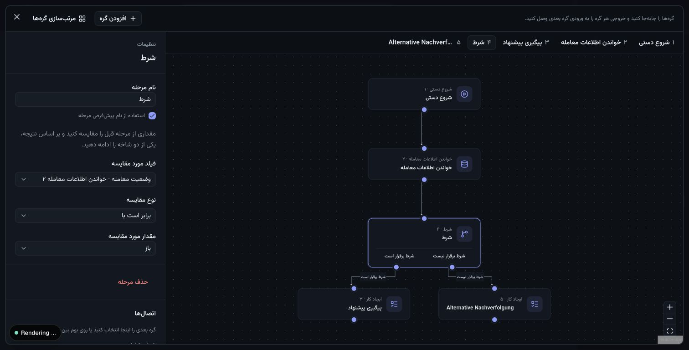
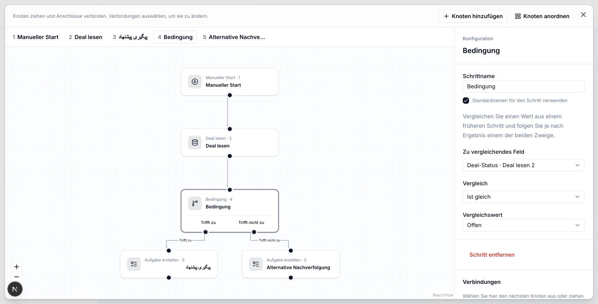
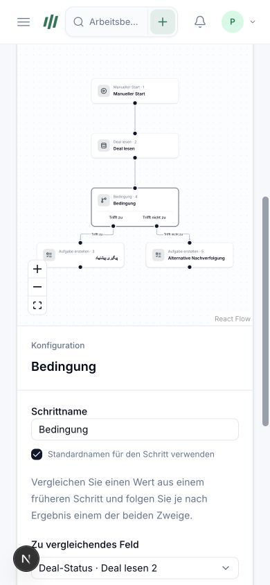
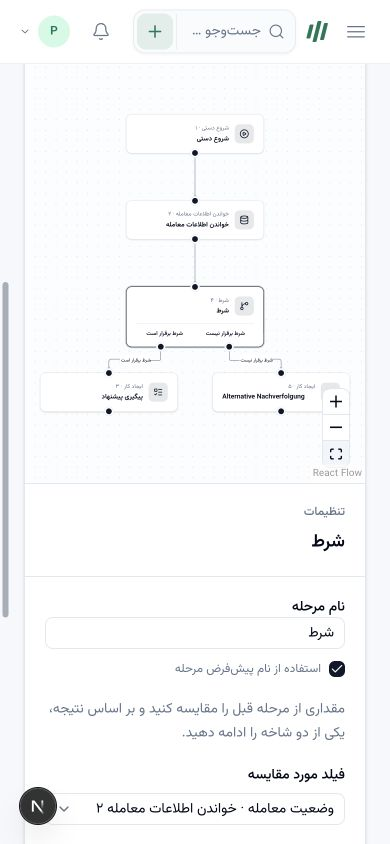
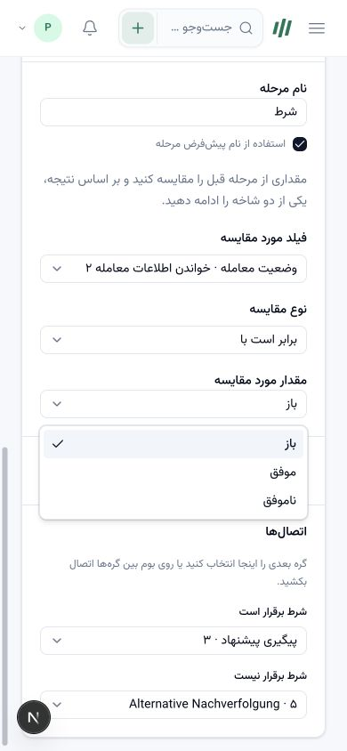
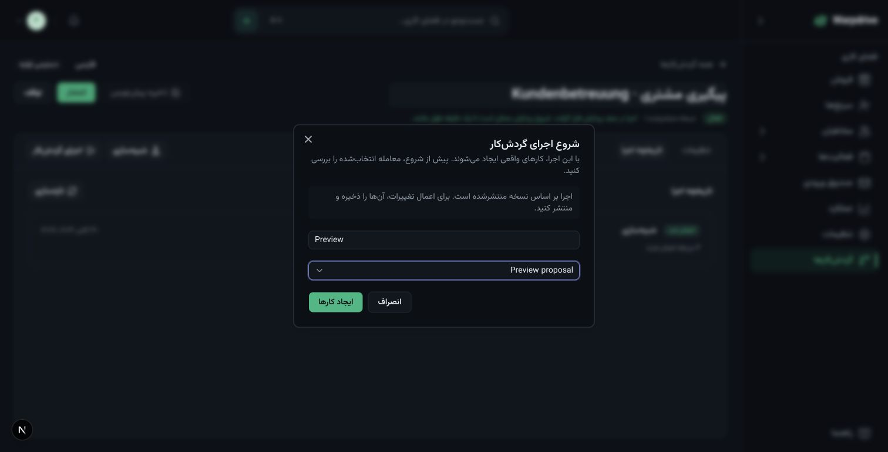
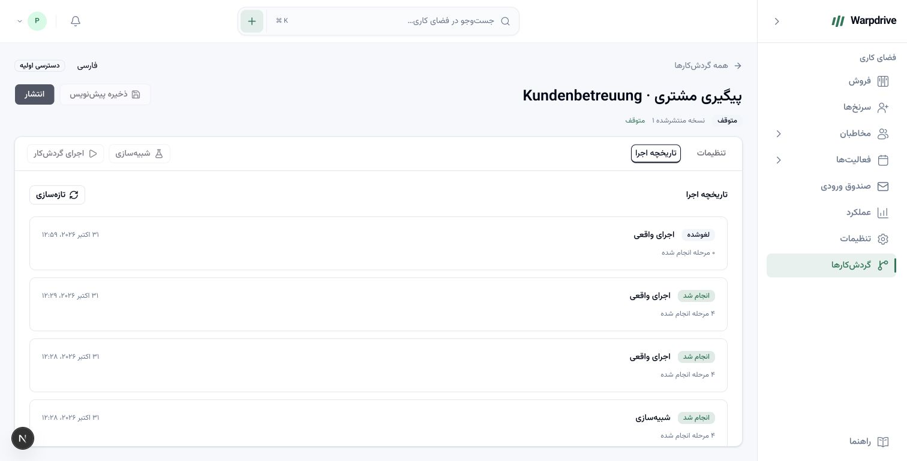

# Visual node builder UI review

Updated 31 October 2026 on `codex/visual-workflows`, based on merged Better Auth main
`8539fe8`. Captures use synthetic loopback CRM records. They are local workflow evidence,
not customer acceptance or a production deployment.

The editor preserves the current shell, local Inter/Vazirmatn fonts, theme tokens, sidebar,
and shared Radix controls. [Mobbin references](ux-design-reference.md) informed the contextual
configuration panel, action picker, and separate configuration/testing/publication stages.
No proprietary application code or visual assets were copied.

## Actual graph editing

The editor now has draggable nodes and explicit editable connections. New nodes start
unconnected; removing a node does not silently bridge the remaining steps. The reviewed
process was manual start → read deal → condition → one of two task nodes.

Observed in Chrome:

- Moved the read node using the pointer and observed its connections follow it.
- Added a condition and second task from the node palette.
- Dragged an existing edge endpoint from a task onto the condition input.
- Drew both condition branches using their separate output handles.
- Arranged the graph, saved, reloaded, and retained its connections and positions.
- Rejected an occupied-input connection with localized feedback and no graph mutation.
- Disconnected and reconnected a branch using the per-node connection controls.
- Observed publication disabled while the branch and its mappings were incomplete.
- Added a temporary node inside focused editing and deleted it with the keyboard.
  The other five nodes and four connections remained, and selection returned to the start.
- Used Escape to leave focused editing and verified focus returned to its launch button.
- Used Backspace inside a task-title input without deleting graph nodes.
- Created a Farsi blank workflow through the starting-point picker, including keyboard
  selection, and verified that it contained only the manual start node.

The graph keeps physical port meaning and saved coordinates. Farsi node content and the
surrounding panels use RTL. The custom German task name remains German intentionally.

## Language switching

Switched a dirty graph from German to Farsi to English, and inspected German again. The
connections and camera transform remained unchanged. Automatic/legacy generated node titles,
branch labels, configuration controls, messages, and step numbers followed the locale.
Custom Persian/German step names, the mixed-language workflow name, literal task text, and
unsaved-change state remained intact. Saved content was also verified in PostgreSQL.

Deal-status choices show Open/Offen/باز and the corresponding localized alternatives while
persisting `open`/`won`/`lost`. Boolean choices are localized too. Available mappings come
from connected ancestors, with unavailable mappings called out after disconnection.
A regression test additionally verifies that existing conflict feedback retranslates during
a live language change without replacing the local draft.

## Responsive and appearance checks

Inspected desktop English, Farsi, and German during editing and execution, with light and
dark samples. Focused editing gives longer processes more usable space. At narrow widths,
the existing mobile drawer replaces the sidebar, actions wrap, the step selector scrolls
horizontally, and configuration stacks below the canvas.

At 390 pixels the inspected document width was 390 and the canvas width was 340, without
page-level horizontal overflow. A desktop-to-mobile resize also left all five rendered nodes
inside the canvas without manually pressing Fit. At 1024 pixels the inspected document/canvas widths were
1024/724. Temporary viewport overrides were reset after testing.

Issues found and corrected during the review:

- Connection handles were transparent because channel-based theme tokens were used as
  complete CSS colors. Canvas colors now wrap the tokens in `hsl(...)`.
- Node measurements were discarded on rerenders, invalidating React Flow initialization.
  Measurements are retained independently from saved layout and do not dirty the draft.
- Validation messages compressed the canvas. They now live in the scrolling inspector.
- Narrowing the viewport could leave nodes off-screen at the desktop pan position.
  Substantial width changes refit the graph; normal rerenders retain the camera.
- Long toolbar instructions consumed too much mobile space. Copy is shorter and the
  arrange action becomes a labeled icon at narrow widths.
- Generated names and stored feedback could retain their creation language. Automatic
  names resolve through the active catalog and feedback stores message keys.
- Search initially offered an empty selection menu. It now explains the two-character
  threshold and exposes localized loading/no-results feedback before selection is available.

## Publication, simulation, execution, and cancellation

The actual browser journey included fresh-authentication refusal with the existing Security
settings link, followed by publication under a fresh synthetic test session. This fixture
qualifies workflow behavior; it does not establish real provider/MFA onboarding.

Observed a completed simulation, a true-path live run with an open synthetic deal, and a
false-path live run after changing that deal to won. PostgreSQL retained zero tasks after
simulation, one Persian task after the true-path run, and one additional German task after
the false-path run. Each completed run recorded four executed steps, not both branches.

Stopped only the isolated workflow consumer, admitted another run through the Farsi UI,
observed its queued status, and cancelled it. The status became cancelled with zero executed
steps. Pausing the workflow disabled new simulation/live admissions.

This capture uses the preview account's Gregorian/UTC preferences. The earlier
[Iranian-calendar history capture](../images/workflows/history-fa.jpg) demonstrates
9 Aban 1405/Tehran display for its corresponding instants. Neither proves calendar-aware
scheduling or recurrence.

## Verification boundary

Current feature unit coverage includes graph editing, layout persistence, ancestor mappings,
strict conditional evaluation, prototype-safe bindings, translated names/status values,
feedback translation, retained measurements, and responsive camera behavior. Real PostgreSQL
coverage includes both branch outcomes alongside authority, concurrency, rollback, and
recovery tests. [Status](status.md) records the commands and result counts.

The full WF-005/040 release gate remains open. Complete keyboard-only journeys, screen-reader
and reduced-motion review, every locale/theme/error/permission-state combination, very long
workflows, unsaved in-app route navigation, grouped conditions, waits, publish-impact review,
and all three R1 acceptance templates still require qualification. Chrome automation had
intermittent control timeouts and the development server hit a hot-reload startup timeout;
checks were resumed after observing the actual page state. These previews do not establish
production runtime reliability or a cross-browser/device certification.
